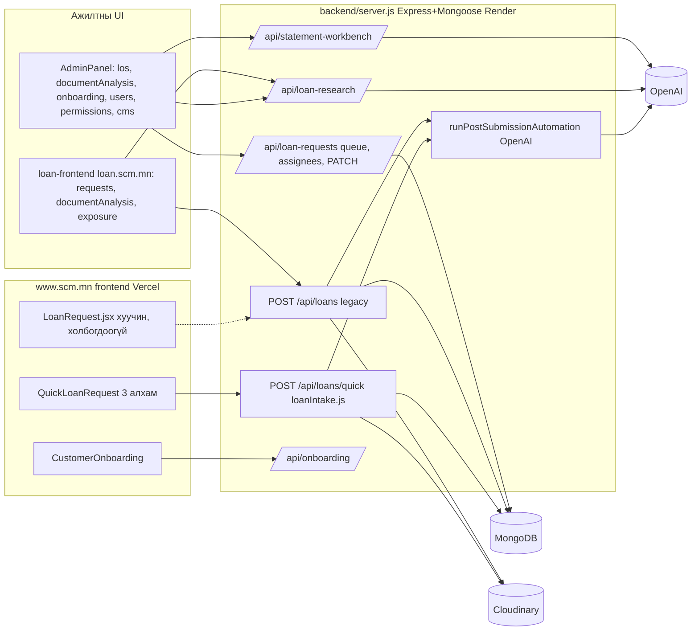
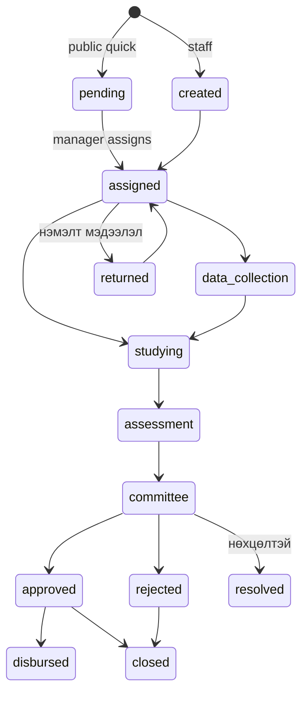

# Зээлийн хүсэлт -> Task management: одоогийн архитектур (Discovery)

Огноо: 2026-11-20. Үүрэг: architect (зөвхөн уншилт, код өөрчлөөгүй). Хамрах хүрээ: `repos/scm-web`.
Үл тооно: `frontend/src/App.jsx`, `main.jsx`, `frontend/src/concept/` дахь бусад uncommitted ажил.
Анхаар: `server.js`-ийн зарим мөрний монгол текст кодчилол эвдэрсэн (mojibake, жш. 6553, 7390).

## 0. Гол дүгнэлт

1. **loan.scm.mn (`loan-frontend/`) нь нийтийн маягт БИШ**, ажилтны дотоод LOS апп: зөвхөн `Login` + `Dashboard` (`loan-frontend/src/App.jsx:41`; табууд requests / documentAnalysis / exposure `loan-frontend/src/pages/Dashboard.jsx:60-62`). Нийтийн хүсэлт зөвхөн www.scm.mn (`frontend/`)-ээс ирнэ. Хэрэглэгчийн "loan.scm.mn-ээс ирэх хүсэлт" гэсэн ойлголтыг батлах шаардлагатай (Open Q4).
2. **Нийтийн хүсэлтийн 2 endpoint зэрэг амьд**: шинэ `POST /api/loans/quick` (`backend/loanIntake.js:153`, UI `frontend/src/components/QuickLoanRequest.jsx:106`) ба хуучин `POST /api/loans` (`backend/server.js:3241`, UI `frontend/src/components/LoanRequest.jsx:325`; App.jsx:53 нь `QuickLoanRequest`-ийг `LoanRequest` нэрээр lazy-load хийдэг тул хуучин UI одоо холбогдоогүй, харин endpoint нь нээлттэй хэвээр).
3. **Хуваарилалт аль хэдийн байгаа**: `assignee{userId,name}`, `PATCH /api/loan-requests/:id` (`loanIntake.js:252`), `GET /api/loan-requests/assignees` (`:204`), role+assignment scope (`requestScope`, `canAccessRequest`, `loanIntake.js:~8-13`), статус `assigned`. Task management-ийг шинээр биш, үүн дээр өргөтгөх нь зохимжтой.
4. **Дэд бүтээгдэхүүн (sub-product) ба бүтээгдэхүүн бүрийн маягтын тохиргоо БАЙХГҮЙ.** Бүтээгдэхүүн хоёр газар тодорхойлогдсон: `shared/loanFormConfig.js:8-17` (`LOAN_PRODUCTS`, 8 id; backend validation үүнийг ашиглана `loanIntake.js:~29`) ба `ProductContent` CMS (`productKey`, текст нөхцөл). `FormConfig` (формId 'loan'|'trust') нь хуучин маягтад зориулагдсан, quick маягт үүнийг уншдаггүй.
5. **Имэйл илгээх код БАЙХГҮЙ** (backend deps-д nodemailer/Resend/SendGrid/SMTP алга; `grep -i smtp|nodemailer|sendgrid|resend|mailgun` үр дүнгүй). Quick intake-д email заавал (`loanIntake.js:~35`); хуучин `/api/loans`-д заавал биш.
6. **Хадгалах "Баримт AI уншилт" цэс** = `LoanResearch documentOnly` -> `StatementWorkbench` (`AdminPanel.jsx:1045,1074-1075`; `loan-frontend/src/pages/Dashboard.jsx:61,239`; `shared/StatementWorkbench.jsx`; API `/api/statement-workbench/*` `server.js:5007-5090`, `/api/loan-research/analyze-*`). Гэхдээ `LoanResearch.jsx` нэг компонент дотор "судалгаа" ба "documentOnly" горимыг хольсон (`:909,943-945,2085-2194,3246`), салгахдаа болгоомжил.
7. **Админ UI хоёр хуулбартай**: `frontend/src/components/*` (www.scm.mn/admin, AdminPanel) ба `loan-frontend/src/*`; файлууд ялгаатай (diff). `frontend/` хувилбар шинэ `/api/loan-requests` queue ашиглана (`LoanOrigination.jsx:150,171,185,402`, `LoanRequestQueue.jsx:63,80,108,126`); `loan-frontend/` хуучин `/api/loans` + `PUT /api/loans/:id` ашиглана (`loan-frontend/src/api.js:39-44`, `LoanOrigination.jsx:519-642`). Хоёуланд нь өөрчлөлт хийх эсэх Open Q4.
8. **`backend/models/LoanRequest.js` ба `models/User.js` нь dead code**: `server.js` өөрийн inline схемийг бүртгэнэ (`LoanRequest` `server.js:~360-406`, `User` `:340-349`), репод `models/LoanRequest|User` импортлосон газар олдсонгүй (`FormConfig` л импортлогдсон `server.js:27`). Тиймээс бодит схем нь inline: `status` enum-гүй String.

## 1. Бүрэлдэхүүн (одоогийн)

## 2. Нийтийн хүсэлтийн entry points

### 2.1 www.scm.mn QuickLoanRequest (идэвхтэй)
- Routing: `frontend/src/App.jsx:53` (lazy), `:511` render; бүтээгдэхүүн `initialProduct` эсвэл `?product=` query-ээр.
- Бүтээгдэхүүний id mapping хатуу кодлогдсон `PRODUCT_IDS = {1:biz_loan,2:car_purchase_loan,3:cons_loan,5:credit_card,6:re_loan,7:line_loan}` (`QuickLoanRequest.jsx:6`).
- Алхам: Холбоо барих / Зээлийн хэрэгцээ / Баримт ба илгээлт (`:15`).
- Талбар (state `:31`): borrowerType, name (firstName эсвэл contactName болж явна), orgName, phone, email, loanType, amount, term, repaymentSource, purpose, collateralType, consent. Frontend validation `:41-62`.
- Баримт (`DOCUMENTS` `:7-14`): file_id, file_address, file_social, file_bank (max 4), file_credit, file_car_photos, file_prop_map (бусад max 3); 10MB/файл, нийт 12 файл/50MB; pdf/jpeg/png/webp.
- Баримт хавсаргах нь **заавал биш** (`docs/quick-loan-intake.md`); "required checkbox" тохиргоо байхгүй.
- Хариу `{applicationReference}` = `SCM-YYYY-XXXXXX`.

### 2.2 Хуучин LoanRequest.jsx -> `POST /api/loans`
- FormData: scalar + `collateralJSON, vehicleJSON, collateralsJSON, guarantorsJSON, orgCeoJSON, orgOwnerJSON` + `file_*` (`LoanRequest.jsx:313-325`).
- Backend `server.js:3241`: auth, rate limit, MIME шалгалтгүй; Cloudinary **public** (`server.js:293-297`), multer `.any()` 20 файл/50MB (`:298-306`). Нийтийн endpoint-ийн аюулгүй байдлын эрсдэл.

### 2.3 CustomerOnboarding (харилцагчийн бүртгэл, зээл биш)
- `POST /api/onboarding` (`server.js:3579`), schema `:409-477`, статус `pending,new,contacted,in_review,approved,rejected,converted,archived` (`:410`), `ONBOARDING_UPDATE_ROLES` (`:412`), `assignee`, `reviewerNote`, `tags`. Task загварт жишиг болно, зээлээс тусдаа.

### 2.4 Бусад
- Zentro (`ZentroLoanRequest`, `POST /api/zentro/public/loan-requests` `server.js:7761`) тусдаа бүтээгдэхүүн, хамрахгүй.

## 3. Backend

### 3.1 Модель
- **LoanRequest (inline, бодитоор ашиглагдаж буй)** `server.js:~360-406`: selectedProduct, amount, term, userType, lastname, firstname, regNo, phone, email, address, `status` (String default 'pending', enum-гүй), `applicationReference` (index), `intakeVersion` (immutable), `workflowRevision` (optimistic lock), org талбарууд, purpose, repaymentSource, `assignee{userId,name}`, `source` enum web|staff, createdByStaff, createdByUser, selfieUrl, fileNames[], `fileDetails[{fieldName,fileName,fileUrl,mimeType,size,publicId,deliveryType}]`, `applicationData` Mixed, `aiLoanOfficer` Mixed, `complianceReview` Mixed, createdAt. (strict mode: `models/LoanRequest.js` нь `strict:false` боловч dead.)
- Статусууд (`loanIntake.js:4`): pending, created, assigned, data_collection, studying, assessment, committee, returned, approved, rejected, resolved, closed, disbursed.
- `applicationData` бүтэц: borrowerType, borrower{}, org{}, loanRequest{product,amount,term,purpose,repaymentSource,...}, collaterals[], guarantors[], otherLoans[], creditBureau, `incomeResearch{bankStatementAnalyses[],socialInsuranceAnalysis}`, consents, `intake{version:'quick-v1',documentsOptional:true}`, `autoIntake{status,extracted,errors}` (`loanIntake.js:91-99`, `server.js:3337-3392`). `otherLoans[]` хоосон массив хэлбэрээр байгаа; "үлдэгдэл + сарын төлбөр"-ийн талбар нэр тодорхойгүй.
- **LoanResearch** `server.js:~712-745`: borrower (Mixed, `sourceRequestId`), outputs (Mixed), files{bankStatements, socialInsurance, creditReference}, createdBy, status 'draft', embedding (RAG).
- **FormConfig** `backend/models/FormConfig.js`: `{formId unique, fields[{fieldKey,label,placeholder,isRequired,isEnabled,order}]}`; `GET /api/form-config/:formId` public, `PUT` admin (`server.js:7384-7397`, upsert-гүй `findOneAndUpdate`); admin UI `AdminPanel.jsx:689-690,917`.
- **ProductContent** `backend/models/ProductContent.js`: productKey unique, title, shortDesc, description, chatbotText, individual/organization{conditions[],requirements[]}, purchase/collateral, зургууд, order, isActive. Routes `server.js:7301-7340`; admin CMS `AdminPanel.jsx:687,827,870`; public `frontend/src/hooks/useCmsData.js:54`. Шаардлага нь **текст** (талбар биш).
- **User** (inline `server.js:340-349`): name, email unique, password (bcrypt), role, `roles[]` (PUT-д max 2), isActive, twoFASecret, isTwoFAEnabled.
- **SiteConfig** key/value: `permissions_matrix`, committee (`server.js:1761-1790`, `7416-7444`). **Log** + `createLog` `server.js:1639-1661`.

### 3.2 Auth ба эрх
- JWT `jwt.sign({id,role,roles}, JWT_SECRET, {expiresIn:'1d'})` `server.js:3165`; `authenticateUser` `:1687` (User-г DB-ээс авч `isActive` шалгана); `requireAdmin` `:1708` (зөвхөн admin).
- `userHasPermission(user, section, action, min)` `:1769`; `COMMITTEE_PERMISSION_DEFAULTS` `:1754`; `getCommitteeDecisionAction` `:1784`.
- Request role-ууд (`loanIntake.js` дээд хэсэг): manager = admin, director; staff = + loan_officer, finance_manager.
- 2FA `/api/auth/2fa/*` `:3176-3203`.

### 3.3 Ажилтны жагсаалт (хуваарилалтад)
- `GET /api/loan-requests/assignees` (`loanIntake.js:204`, зөвхөн manager) буцаах талбар `_id name role roles` (**email байхгүй**). `User.email` талбар байгаа тул мэдэгдэл илгээхэд DB-ээс авч болно.
- `GET /api/users` admin (`server.js:6525`), `GET /api/users/list` `_id name role` (`:6527`), `POST/PUT/DELETE /api/users` `:6529-6553` (`PUT` зөвхөн `roles`).
- `TeamMember` нь вэб сайтын CMS "Удирдлагын баг", хэрэглэгч биш.
- Бүтээгдэхүүн бүрийн "default хүлээн авагч" өгөгдөл байхгүй.

### 3.4 Хуваарилалт, төлөв шилжилтийн одоогийн дүрэм
- `validateRequestPatch` (`loanIntake.js:47-73`): зөвшөөрөх талбар `status, note, assigneeId`; manager биш бол зөвхөн assigned, data_collection, studying, assessment, committee, returned, approved, rejected, resolved руу; `returned/rejected`-д шалтгаан заавал; эцсийн төлөв (approved, rejected, resolved, closed, disbursed)-ийг ажилтан өөрчлөхгүй. Дараалал (state machine) албадахгүй.
- `assigneeId` өгөхөд `pending|created|returned` -> `assigned` автоматаар (`loanIntake.js:~268`); ажилтан идэвхтэй ба staff role байх ёстой (`:266-270`).
- Optimistic concurrency `workflowRevision` + `status` (`:~272-278`), 409.
- Лог `loan_request_workflow_updated`.

### 3.5 Endpoint-ууд

| Method Path | Auth | Файл:мөр | Тайлбар |
|---|---|---|---|
| POST `/api/loans/quick` | public, limiter 5/15мин/IP | loanIntake.js:153 | Шинэ intake, Cloudinary authenticated, bytes шалгана |
| POST `/api/loans` | public, хамгаалалтгүй | server.js:3241 | Хуучин intake, public Cloudinary |
| GET `/api/loans` | user | server.js:3423 | Хуучин жагсаалт (500), quick-v1-ийг scope-оор шүүнэ |
| PUT `/api/loans/:id` | user | server.js:3495 | `req.body` шууд `$set`; committee эрх шалгана |
| DELETE `/api/loans/:id` | admin | server.js:3537 | |
| POST `/api/loans/staff` | user | server.js:3561 | status 'created' |
| POST `/api/loans/:id/files`; DELETE `.../files/:fileId` | user | loanIntake.js:176 (quick), server.js:3789, 3819 (legacy) | |
| POST `/api/loans/maintenance/prune-before-date` | user + env flag | server.js:3430 | `ENABLE_LOAN_PRUNE_MAINTENANCE=YES` |
| POST `/api/loans/intake-automation/backfill` | admin | server.js:3685 | |
| GET `/api/loan-requests`, `/:id`, `/assignees`; PATCH `/:id`; POST `/:id/intake-automation` | staff | loanIntake.js:208, 227, 204, 252, 235 | queue/хуваарилалт |
| POST `/api/loans/:id/ai-loan-officer`; GET/POST `/compliance-review` | user | server.js:3725-3759 | |
| GET `/api/loan-research`, `/by-request/:id`; POST `/api/loan-research`, `/similar` | user | server.js:5090, 3837, 6429, 5102 | **Судалгааны процесс (солих)** |
| POST `/api/loan-research/analyze-statement`, `/analyze-credit-reference`; `/api/loans/analyze-id/org/vehicle/property/fico/social-insurance/financial-statements/projected-account-revenue` | user | server.js:5179, 5571, 5263-6008 | AI баримт уншилт |
| GET/POST/PATCH `/api/statement-workbench/*` | user (rules: admin) | server.js:5007-5090 | **Хадгалах AI цэс** |
| `/api/onboarding*` | POST public, бусад staff | server.js:3579-3651 | |
| `/api/form-config/:formId` | GET public, PUT admin | server.js:7384-7397 | |
| `/api/products/content*` | GET public, бусад admin | server.js:7301-7340 | |
| `/api/users*`, `/api/config/permissions|committee` | admin/user | server.js:6525-6553, 7416-7444 | |
| `/api/exposure-monitor/*` | user | server.js:3997-4241 | Хамаарахгүй |

### 3.6 Файл upload ба AI
- Cloudinary config `server.js:288-291`. Quick: memory storage -> `validateIntakeFiles` (magic bytes, 12 файл, 10MB, 50MB нийт) -> `upload_stream({folder:'scm_loan_private', resource_type:'raw', type:'authenticated'})`, signed URL хадгална; алдаа гарвал оруулсан файлуудыг устгана (`loanIntake.js:~132-175`). SSRF хамгаалалт `isAllowedLoanRemoteUrl` (`:101`).
- OpenAI: `server.js:200`, env `OPENAI_API_KEY`; `OPENAI_MODEL` (gpt-4o-mini), `OPENAI_STATEMENT_MODEL` (gpt-4.1-mini) (`:4748`, `:5272`...), `OPENAI_COMPLIANCE_MODEL`.
- `runPostSubmissionAutomation` `server.js:6320` -> `autoExtractSubmittedFiles` `:6194`, `AUTO_INTAKE_VERSION` `:6055`, aiLoanOfficer + compliance. `bankStatementAnalyses` `incomeResearch` дотор (`:829`, `:1381`, `:6283`).
- Quick-ийн AI нөхөлт нь ажилтны өөрчлөлтийг дарахгүй байхын тулд snapshot predicate (`automationWriteQuery` `loanIntake.js:108`, `server.js:6339-6364`). Шинэ талбарыг энэ дүрмийн дагуу хадгалах.

## 4. Админ дэлгэцүүд

### 4.1 www.scm.mn/admin AdminPanel (`frontend/src/components/AdminPanel.jsx`)
Табууд `:1043-1058`: dashboard, **los "Зээлийн үйл явц"**, **documentAnalysis "Баримт AI уншилт"**, onboarding, trusts, finance, cms (products, hero, safety...), users, permissions, logs, settings. API_URL `:309`, token `localStorage scm_auth`.

### 4.2 LoanOrigination (frontend/src/components/LoanOrigination.jsx)
Алхмууд `:18-22`: application "Хүсэлтүүд" -> assessment "Зээлийн үнэлгээ" -> committee "Зээлийн хороо" -> disbursement "Олголт". `application` = `LoanRequestQueue` (`:328`) + `LoanApplicationDetail` (`:314,358`) + `LoanRequestReadiness` (`:262`). `assessment` алхам = embedded **`LoanResearch`** (`:396`) = "зээлийн судалгаа" (солих). Статус шилжүүлэлт `PATCH /api/loan-requests/:id` (`:150-185`); `STATUS_META` `:25-40`.

### 4.3 Бусад админ компонент
- `LoanRequestQueue.jsx`: queue + хуваарилалт (`:63-126`), `STATUS_LABELS`, `PRODUCTS` (7 id, `mortgage` дутуу).
- `LoanRequestReadiness.jsx`: `DOCUMENTS` (`:5-10`, мөн legacy `file_org_bank, file_fico, file_sainscore` түлхүүрүүд), AI intake статус, retry `/api/loan-requests/:id/intake-automation` (`:38-39`).
- `LoanApplicationDetail.jsx`: дэлгэрэнгүй, `PUT /api/loans/:id`, файл, `/api/loan-research/...`.
- `LoanResearch.jsx` (~5.2k мөр loan-frontend): профайл, дансны хуулга, НДШ, ЗМС, санхүүгийн тайлан, RAG `/similar`, `POST /api/loan-research`; `documentOnly` горим = хадгалах AI цэс.
- `LoanExposureMonitor.jsx`, `PermissionMatrix.jsx`, `CustomerOnboarding.jsx`, `ProductTermsEditor.jsx`.
- loan-frontend: `Dashboard.jsx` (requests/documentAnalysis/exposure), хуучин `LoanOrigination.jsx` (4 алхам `:17-20`, `/api/loans`), `api.js:4` API URL `VITE_API_URL` дэмждэггүй.

### 4.4 Одоогийн "зээлийн судалгаа" урсгал

Автомат давхарга: intake-ээс хойш `runPostSubmissionAutomation` (AI талбар нөхөлт + AI зээлийн ажилтан + комплианс); ажилтан гараар `LoanResearch` бичлэг хадгална.

### 4.5 Хадгалах / Солих

| Хэсэг | Шийдэл | Нотолгоо |
|---|---|---|
| "Баримт AI уншилт" цэс (StatementWorkbench, `analyze-*`, `/api/statement-workbench/*`) | ХАДГАЛАХ, өөрчлөхгүй | AdminPanel.jsx:1045,1074; Dashboard.jsx:61; server.js:5007-5090 |
| LOS `assessment` доторх embedded `LoanResearch`, research list/profile, `/api/loan-research` | СОЛИХ | LoanOrigination.jsx:384-410; server.js:5090,6429 |
| Queue + хуваарилалт `/api/loan-requests*` | ӨРГӨТГӨХ (суурь) | loanIntake.js:204-290 |
| AI intake автомат (autoExtract, aiLoanOfficer, compliance) | Шийдэх (Open Q13) | server.js:6320 |
| `FormConfig`, `ProductContent` | Дахин ашиглах эсвэл шинэ Product/SubProduct entity | 3.1 |
| committee, disbursement | Шийдэх (Open Q1); шинэ статусын жагсаалтад approved/disbursed алга | server.js:1784 |
| Хуучин `POST /api/loans` | Нэгтгэх/хаах | server.js:3241 |

## 5. Имэйл, орчин, deployment

- Имэйл: **механизм байхгүй**. backend deps: axios, bcryptjs, cheerio, cloudinary, cors, dotenv, express, jsonwebtoken, mongoose, multer, multer-storage-cloudinary, node-cron, openai, qrcode, rss-parser, speakeasy. Нэмэх: provider (Resend/SendGrid/SMTP) + `scm.mn` DNS SPF/DKIM/DMARC `no-reply@scm.mn`-д. Түлхүүр backend-ийн Render env-д (`process.env.*` хэв маяг `server.js:196-200,288-291`; `.env` commit хийгдээгүй, зөвхөн `frontend/.env.example`).
- Deployment: backend Render (`https://scm-okjs.onrender.com`: `QuickLoanRequest.jsx:30`, `api.js:4`, `server.js:7562`), frontends Vercel (`frontend/vercel.json`, `loan-frontend/vercel.json` SPA rewrites). `render.yaml`/CI файл **олдсонгүй**; backend нь `../frontend/dist` статик үйлчилж болно (`server.js:~7403`).
- Render-ийн cold start/unreliable: имэйлийг request дотор sync биш, `runPostSubmissionAutomationInBackground` (`server.js:1262`) загвараар background-д; `node-cron` dep бий (сануулгад).
- Мэдэгдэж буй env: PORT, JWT_SECRET, MONGO_URI|MONGODB_URI, OPENAI_API_KEY, OPENAI_MODEL, OPENAI_STATEMENT_MODEL, OPENAI_COMPLIANCE_MODEL, CLOUDINARY_*, PUBLIC_API_BASE_URL, ENABLE_LOAN_PRUNE_MAINTENANCE, FB_*, ZENTRO_*, BACKEND_ADMIN_PASSWORD.
- Хажуугийн олдвор: `server.js:7022` дээр admin нууц үгийн **hardcoded default** байна (`ZENTRO_ADMIN_PASSWORD || BACKEND_ADMIN_PASSWORD || '<default>'`). Энэ ажлын хүрээнээс гадуур боловч аюулгүй байдлын асуудал.

## 6. Тест ба командууд
- `node --check backend/server.js`; `node --test backend/loanIntake.test.js backend/safetyNotices.test.js backend/zentroFacebook.test.js shared/heroSliderConfig.test.js` (backend `package.json`-д test script байхгүй; scripts: start, dev, prune:*). Мөн `shared/loanApr*.test.js`, `shared/statementWorkbenchUtils.test.js`.
- `backend/loanIntake.test.js` (201 мөр): quick validation, role+assignment scope, workflow patch дүрэм, rate limiter, MIME bytes, SSRF, AI snapshot predicate, linked research access, public route / queue / assign / retry mock тестүүд (`:113-200` mock chain). Шинэ task логикийг ижил DI+mock загвараар (route registrar функц) бичвэл тестлэхэд хялбар.
- Frontend: `cd frontend && npm run build && npm run lint`; `cd loan-frontend && npm run build && npm run lint`. Хуучин lint өр байгаа (AGENTS.md).

## 7. Өгөгдлийн шилжилтийн эрсдэл
1. **Хоёр intake хувилбар**: `intakeVersion: 'quick-v1'` (immutable) ба legacy (undefined); scope, эрх, PUT дүрэм өөр (`server.js:3423-3428`, `3495-3523`). Шинэ task загвар хоёуланг уншиж чадах ёстой.
2. **Статусын утга давхцал**: хүссэн статус (new, assigned, additional documents, in review, rejected, resolved) vs одоогийн 13: `pending~new`, `returned~additional documents`, `studying|assessment|data_collection~in review`. **`resolved` одоо "Нөхцөлтэй зөвшөөрсөн" (`docs/quick-loan-intake.md`, `LoanRequestQueue.jsx:~8`), шинэ "resolved" өөр утгатай.** Хуучин `approved/committee/disbursed/closed` бичлэг хадгалагдсан. Зөвлөмж: тусдаа `taskStatus` талбар эсвэл mapping давхарга; хуучин `status` утгыг дахин утгатай болгохгүй.
3. **Dead model**: `models/LoanRequest.js` (status enum 7 утгатай) ашиглагдахгүй; харин хэн нэгэн үүнийг импортлох юм бол `assigned/returned/closed` хадгалахад алдаа гарна. Шинэ ажлыг models/ руу гаргахдаа inline схемтэй давхардахгүй байх ёстой.
4. **`applicationData` Mixed** + top-level (`strict`-гүй) хоёулаа ашиглагдана; AI automation `applicationData`-г snapshot predicate-аар шинэчилдэг. Шинэ тохиргоо-тод хариултыг (custom fields) тусдаа top-level (жш. `taskData`) талбарт хадгалбал AI-тай мөргөлдөхгүй. Хэрэв `applicationData` дотор хадгалбал `automationWriteQuery` дүрэмд нийцүүл.
5. **Файлын түлхүүр хатуу**: `QUICK_FILE_FIELDS` (`loanIntake.js:3`), multer `.fields` (`:~134`), `quickApplicationData`, `autoExtractSubmittedFiles`, `LoanRequestReadiness.DOCUMENTS`. Тохиргоо-тод файл (custom) нэмэх = fixed-field multer-г динамик болгох (аюулгүй байдлын шинэ хяналт: тоо, хэмжээ, MIME). "ЗМС scoring" ба "ЗМС лавлагаа"-г ялгах legacy түлхүүрүүд `file_fico`, `file_sainscore` бий (`LoanRequestReadiness.jsx:9`).
6. **Хуучин public `/api/loans`** хаах/чиглүүлэхэд `loan-frontend` (PUT /api/loans/:id) ба хуучин LoanRequest.jsx нөлөөлнө.
7. Хуучин бичлэгт email хоосон байж болно -> auto-reply алгасах логик.
8. **Бүтээгдэхүүний id хоёр+ эх үүсвэр**: `LOAN_PRODUCTS` (8, `mortgage` орсон) vs `QuickLoanRequest.PRODUCT_IDS` (6) vs `LoanRequestQueue.PRODUCTS` (7) vs `ProductContent.productKey`. Sub-product холбох түлхүүрийг шийд.

## 8. Бусад эрсдэл
- Cloudinary: хуучин файлууд public URL, quick нь signed/authenticated. Шинэ preset файл (иргэний үнэмлэх, НДШ, дансны хуулга, ЗМС) PII тул authenticated хэвээр.
- Нийтийн endpoint шинээр/өргөтгөхөд (AGENTS.md): validation, size limit, rate limit. `createIntakeLimiter` in-memory, нэг instance (Render-д олон instance бол хуваагдана).
- Имэйл: spam/abuse (auto-reply-г limiter-ээр хамгаалах), bounce, илгээлт бүтэлгүйтсэн ч хүсэлт хадгалагдсан хэвээр байх (fire-and-forget + log), PII-г имэйлд хамгийн бага байлгах.
- `PUT /api/loans/:id` нь `req.body`-г шууд `$set` хийнэ (mass assignment `server.js:3495-3523`): task статусыг энэ замаар дамжуулахыг хориглох.
- `server.js` 8.9k мөр монолит: шинэ модулийг `loanIntake.js` хэв маягаар тусдаа файлд (DI) гаргах нь AGENTS.md-тэй нийцнэ.
- Тохиргооны өөрчлөлт (алхам/талбар) илгээсэн хүсэлтэд ухраж нөлөөлөхөөс сэргийлж хүсэлт бүр илгээх үеийн тохиргооны snapshot хадгалах.

## 9. Бизнес эзэмшигчид тавих нээлттэй асуултууд
1. Шинэ task workflow нь **зээлийн хороо / олголт**-ыг (committee, approved, disbursed) орлох уу, эсвэл task дууссаны дараа хэвээр үргэлжлэх үү? Шинэ статусын жагсаалтад approved/disbursed алга.
2. Шинэ `resolved` = "шийдвэрлэгдсэн"; одоогийн `resolved` = "нөхцөлтэй зөвшөөрсөн". Хэрхэн ялгах, хуучин бичлэгийг хөрвүүлэх үү?
3. Хуучин (legacy + quick-v1) хүсэлтүүд шинэ workflow-д орох уу, зөвхөн шинээр ирэх хүсэлт үү?
4. loan.scm.mn нь ажилтны UI гэдгийг батлах. "loan.scm.mn-ээс ирэх хүсэлт" гэж нийтийн маягт бодитоор байгаа юу (өөр апп)? Хоёр админ UI-ийн (`frontend` AdminPanel vs `loan-frontend`) аль нь үндсэн, нөгөөг нь засах уу?
5. Дэд бүтээгдэхүүн (хугацаат/улирлын): эхлэх/дуусах огноо, нэг бүтээгдэхүүнд зэрэг хэдэн идэвхтэй, дуусахад нийтийн сайтаас нуух, илгээсэн хүсэлт яах, public сонголт/URL?
6. Бүтээгдэхүүн бүрийн default хүлээн авагч: нэг хүн үү, олон (round-robin) уу? Идэвхгүй/чөлөөтэй үед?
7. Preset widget-үүд: байгууллагын, барьцаа, батлан даагч, хамтран зээлдэгчийн талбарууд хэвээр үлдэх үү? "Бусад газрын идэвхтэй зээл" нь олон мөр байх уу?
8. Файл: заавал/сонголттой, хязгаар (одоо 10MB, 12 файл, PDF/JPG/PNG/WEBP), "ЗМС лавлагаа" ба "ЗМС scoring" тусдаа файл уу? Хүсэлт гаргагч дараа нь нэмэлт баримт оруулах (нэвтрэлтгүй холбоос) шаардлагатай юу (`additional documents`)?
9. Хүсэлт гаргагч төлөвөө харах уу (дугаараар шалгах)? Auto-reply агуулга, хэл, лого, reply-to?
10. Имэйл provider (SMTP/Resend/SendGrid), `scm.mn` DNS (SPF/DKIM/DMARC) хариуцагч, сарын хэмжээ?
11. Ажилтны мэдэгдэл: зөвхөн хуваарилалт үед үү, статус/нэмэлт баримт ирэхэд үү, SLA сануулга (cron) үү?
12. Хэн тохиргоо засах эрхтэй: зөвхөн `admin` (одоогийн `requireAdmin`) уу, `director` уу?
13. Одоогийн AI автомат нөхөлт (autoExtract, aiLoanOfficer, compliance) task workflow-д үргэлжлэх үү? (Зөвхөн "Баримт AI уншилт" цэс хадгалагдана гэж ойлгосон.)
14. Хувийн мэдээллийн (регистр, үнэмлэх) хадгалах хугацаа, устгах бодлого, consent текст.
