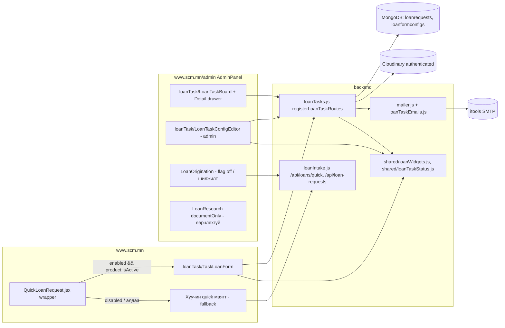
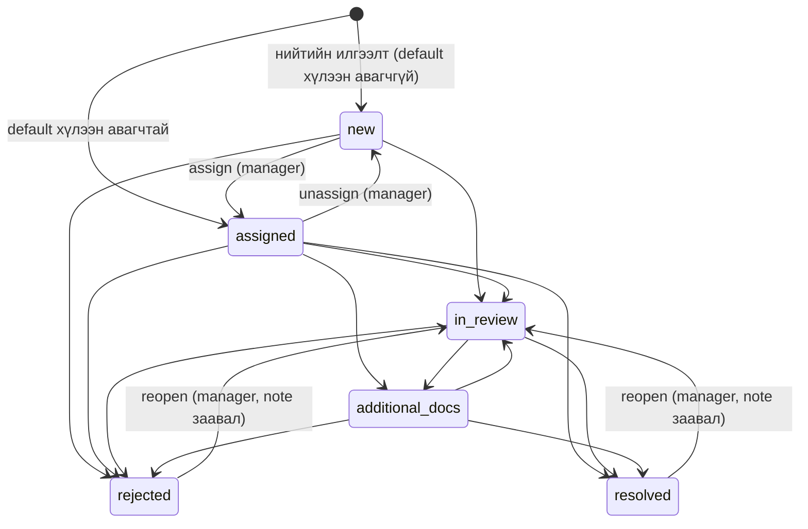

# Зээлийн хүсэлтийн Task management — дизайн ба хэрэгжүүлэх төлөвлөгөө

Огноо: 2026-11-20. Үүрэг: architect + decision-maker (зөвхөн дизайн, код өөрчлөөгүй).
Эх сурвалж: `docs/architecture/loan-task-management-current.md` (discovery), шийдвэрүүд `docs/adr/0004-loan-task-management.md`.
Хамрах хүрээ: `backend/`, `shared/`, `frontend/` (www.scm.mn ба www.scm.mn/admin). `loan-frontend/`, `zentro-frontend/`, `frontend/src/App.jsx`, `main.jsx`, `frontend/src/concept/` — ӨӨРЧЛӨХГҮЙ.

## 0. Discovery-г кодоор баталгаажуулсан олдвор (шинэ нэмэлтүүд тодоор)

| Мэдэгдэл | Баталгаа |
|---|---|
| Backend нь ESM (`"type":"module"`), `shared/*.js`-ийг шууд импортлодог | `backend/package.json`, `loanIntake.js:1` |
| `LoanRequestSchema` inline, **strict** (Mongoose default) | `server.js:378-405`. **Шинэ талбарыг схемд нэмэхгүй бол `$set` чимээгүй хаягдана.** |
| **Одоогийн PATCH `note` → `approvalNote` хадгалагддаггүй** (схемд `approvalNote` алга) | `loanIntake.js:59`, `server.js:378-405`. Хуучин урсгалын алдаа; шинэ дизайнд тэмдэглэл `taskHistory`-д хадгалагдана. |
| `/api/loans/:id` middleware зөвхөн `intakeVersion==='quick-v1'`-д эрх/scope шалгадаг; бусад бичлэгт legacy route-ууд ямар ч нэвтэрсэн хэрэглэгчид нээлттэй | `server.js:3219-3237`, `3425` |
| `quick-v1` шалгалт 8 газар тархсан | `server.js:3225,3425,3510,3841,6336,6337,6493`; `loanIntake.js` `assertLinkedResearchAccess`, `researchVisibilityStages` |
| `App.jsx:53` нь `./components/QuickLoanRequest`-ийг lazy-load; AdminPanel `App.jsx:55,476` | Шинэ нийтийн маягтыг `QuickLoanRequest.jsx` дотор холбосноор App.jsx-д хүрэхгүй |
| AdminPanel `activeTab==='los'` → `LoanOrigination`; admin-only цэсүүд `user?.role==='admin'` | `AdminPanel.jsx:1042-1075` |
| **`trust proxy` тохируулаагүй** → `createIntakeLimiter` нь `req.ip` (Render proxy-ийн хаяг байж болзошгүй)-оор түлхүүрлэнэ; бүх зочин нэг 5/15мин сав хуваах эрсдэл | `server.js:254` тайлбар, `loanIntake.js:79` |
| Хуучин `POST /api/loans`-ийг зөвхөн холбогдоогүй `frontend/src/components/LoanRequest.jsx:325` дууддаг | grep (loan-frontend зөвхөн GET/PUT) |
| `file_fico`, `file_sainscore` түлхүүрүүд AI extraction-д `credit` бүлэгт орно | `server.js:6064`, `LoanRequestReadiness.jsx:7` |
| Mongoose `[subdoc]` массив default `[]` — хуучин бичлэгийг `save()` хийхэд хоосон массив бичигдэнэ | Mongoose 8 зан төлөв → шинэ массивуудад `default: undefined` заавал |

## 1. Шийдвэрийн хураангуй (дэлгэрэнгүй ADR 0004)

1. **Хадгалалт**: шинэ хүсэлтүүд одоогийн `LoanRequest` collection-д; task талбаруудыг (`taskStatus`, `taskHistory`, …) `LoanRequestSchema.add()`-аар нэмнэ. Тусдаа `LoanTask` collection үүсгэхгүй.
2. **intakeVersion**: шинэ маягтын бичлэг `intakeVersion: 'quick-v1'` (= "хуваарилалтаар хамгаалагдсан intake") хэвээр, ялгах тэмдэг `formVersion: 'task-v1'`. Ингэснээр 8 газрын одоогийн хамгаалалт автоматаар үйлчилнэ.
3. **Бүтээгдэхүүн**: кодын `shared/loanFormConfig.js` `LOAN_PRODUCTS` (8) нь бүтээгдэхүүний жагсаалтын эх үүсвэр хэвээр. Шинэ `LoanFormConfig` collection — бүтээгдэхүүн бүрт 1 баримт, дэд бүтээгдэхүүн embedded. `ProductContent`, `FormConfig`-д хүрэхгүй.
4. **Статус**: `taskStatus` шинэ талбар + уншихдаа хуучин `status`-аас mapping. Хуучин `status`, `workflowRevision`-ийг шинэ endpoint хэзээ ч бичихгүй; конкурент хамгаалалт `taskRevision`.
5. **Хуваарилалт**: одоогийн `assignee{userId,name}` талбарыг ашиглана (одоогийн PATCH аль хэдийн үүнийг бичдэг workflow талбар). **Хэрэглэгчийн батлах шаардлагатай** (ADR 0004 D5).
6. **AI автомат** (`runPostSubmissionAutomation`): task-v1 илгээлтэд default-оор ажиллуулахгүй (`LOAN_TASKS_AI_AUTOMATION=true` үед л). "Баримт AI уншилт" цэс өөрчлөгдөхгүй.
7. **Feature flag**: backend env `LOAN_TASKS_ENABLED` + бүтээгдэхүүн бүрийн `isActive`. Flag унтраавал frontend өөрөө хуучин QuickLoanRequest ба LoanOrigination руу буцна.
8. **Имэйл**: `nodemailer` SMTP (itools), process дотор background, queue-гүй.

## 2. Бүрэлдэхүүн



## 3. Өгөгдлийн загвар

### 3.1 `shared/loanWidgets.js` — preset widget registry (frontend+backend нэг эх сурвалж)

Export (гэрээ — WP-A бичнэ, WP-B зөвхөн импортлоно):

```js
export const LOAN_WIDGETS_VERSION = 1;
export const FILE_FORMATS = { pdf: 'application/pdf', jpg: 'image/jpeg', png: 'image/png', webp: 'image/webp' };
export const FIELD_TYPES = ['text', 'textarea', 'number', 'date', 'select', 'yesno', 'file', 'composite'];
export const CUSTOM_FIELD_TYPES = ['text', 'number', 'date', 'select', 'yesno', 'file'];
export const LIMITS = { steps: 8, fieldsPerConfig: 60, subProducts: 20, selectOptions: 30, filesTotal: 12, bytesTotal: 50 * 1024 * 1024, fileMaxMb: 10, customFileMaxFiles: 5, answersJsonBytes: 32 * 1024 };
export const PRESET_WIDGETS = [ /* доорх хүснэгт */ ];
export const PRESET_BY_KEY;                       // { [key]: preset }
export function resolveField(fieldRef)            // stored FieldRef -> FieldDef (public shape, §5.2)
export function resolveSteps(steps)               // StepStored[] -> Step[] (FieldDef-тэй)
export function validateConfig(config)            // -> { ok, errors: { 'steps.0.fields.2.label': msg }, value: normalized }
export function validateAnswers(steps, answers, { now } = {}) // -> { ok, errors: { [key]: msg }, value: normalized }  (файлгүй)
export function fileRulesFor(steps)               // -> { [fieldKey]: { storageField, accept: [mime], maxBytes, maxFiles, required, label } }
export function mirrorAnswers(value)              // normalized answers -> top-level LoanRequest талбарууд (§3.3)
export function buildDefaultConfig(productKey)    // одоогийн quick маягтыг давтах config (§6.3)
export function isSubProductLive(sub, now = new Date()) // isActive && startDate<=UB өнөөдөр<=endDate
export function ubDate(now)                       // 'YYYY-MM-DD' Asia/Ulaanbaatar (UTC+8, DST-гүй)
export function slugify(text)                     // кирилл -> латин slug (дэд бүтээгдэхүүний id-д)
```

Preset widget-үүд (`key` нь config-д хадгалагдах тогтмол түлхүүр; `storage` = LoanRequest-ийн top-level эсвэл `fileDetails.fieldName`):

| key | Нэр (default label) | type | Утгын формат / шалгалт | storage |
|---|---|---|---|---|
| `full_name` | Овог нэр | composite | `{lastName, firstName}` тус бүр 1-100 тэмдэгт; required үед хоёулаа | `lastname`, `firstname` (org үед `contactName`) |
| `birth_date` | Төрсөн огноо | date | `YYYY-MM-DD`, нас 18-100 | answers + `applicationData.borrower.birthDate` |
| `register_number` | Регистрийн дугаар | text | uppercase, `/^[А-ЯЁӨҮ]{2}\d{8}$/` | `regNo` (PII: жагсаалт, лог, имэйлд орохгүй) |
| `phone` | Утас | text | хоосон зай/хаалт хасаад `/^\+?\d{8,15}$/` | `phone` (+org үед `contactPhone`) |
| `email` | Имэйл | text | ≤254, lowercase, `/^[^\s@]+@[^\s@]+\.[^\s@]+$/` | `email` |
| `address` | Оршин суугаа хаяг | textarea | 1-500 | `address` |
| `loan_amount` | Зээлийн дүн (₮) | number | safe integer 1..1e12 | `amount` |
| `loan_term` | Хугацаа (сар) | number | integer 1..120 | `term` |
| `repayment_source` | Эргэн төлөгдөх орлогын эх үүсвэр | textarea | 1-1000 | `repaymentSource` |
| `purpose` | Зориулалт | textarea | ≤1000 | `purpose` |
| `other_loans` | Өөр банк/ББСБ-д идэвхтэй зээлтэй эсэх | composite | `{hasActiveLoans: bool, balance, monthlyPayment}`; `true` үед balance, monthlyPayment integer 0..1e12 заавал | answers + `applicationData.otherLoans=[{source:'self_declared',balance,monthlyPayment}]` |
| `borrower_type` | Хүсэлт гаргагч | select | `individual`\|`organization` | `userType` |
| `org_name` | Байгууллагын нэр | text | 1-200; `borrower_type=organization` үед л харагдана/шалгагдана | `orgName` |
| `collateral_type` | Барьцаа | select | `vehicle, real_estate, account_revenue, contract, none` | `collateralType` (applicationData) |
| `id_reference` | Иргэний үнэмлэхийн лавлагаа | file | default pdf/jpg/png/webp, 10MB, max 3 | `file_id` |
| `address_reference` | Оршин суугаа газрын лавлагаа | file | ″ | `file_address` |
| `ndsh_reference` | НДШ лавлагаа | file | ″ | `file_social` |
| `bank_statement` | Дансны хуулга | file | ″ max 4 | `file_bank` |
| `zms_reference` | ЗМС лавлагаа | file | ″ | `file_credit` |
| `zms_scoring` | ЗМС скоринг | file | ″ | `file_sainscore` |
| `car_photos` | Тээврийн хэрэгслийн зураг | file | ″ | `file_car_photos` |
| `property_docs` | Үл хөдлөх / барьцааны материал | file | ″ | `file_prop_map` |

Preset файлын storage түлхүүрүүд одоогийн `fileDetails.fieldName`-тэй ижил тул `LoanRequestReadiness`, AI extraction (`server.js:6064`) өөрчлөлтгүй ажиллана.

Дүрэм: `phone` preset бүх config-д заавал, `required:true` (ажилтан холбогдох суваг); `full_name` заавал. Зөвшөөрлийн (consent) checkbox-ийг систем үргэлж сүүлийн алхамд нэмнэ (config-д биш). Conditional харагдалт зөвхөн preset-д (`org_name` ← `borrower_type`, `other_loans` дотор); custom талбарт conditional логик v1-д БАЙХГҮЙ (YAGNI).

### 3.2 Шинэ collection `LoanFormConfig` (`backend/models/LoanFormConfig.js`)

```js
// StepStored, FieldRef, SubProduct-ийг { _id: false } subschema эсвэл Mixed + validateConfig-оор баталгаажуулна.
{
  productKey:        { type: String, required: true, unique: true },   // LOAN_PRODUCTS id
  isActive:          { type: Boolean, default: false },                // нийтийн шинэ маягт идэвхтэй эсэх
  baseProductEnabled:{ type: Boolean, default: true },                 // дэд бүтээгдэхүүнгүйгээр үндсэн бүтээгдэхүүнд хүсэлт өгөх
  defaultAssigneeId: { type: String, default: '' },                    // User._id эсвэл ''
  steps:             [StepStored],
  subProducts:       [SubProduct],
  version:           { type: Number, default: 1 },                     // хадгалах бүрт +1 (optimistic lock + snapshot)
  updatedBy:         { userId: String, name: String },
  updatedAt:         { type: Date, default: Date.now }
}
StepStored = { id: /^[a-z0-9_-]{1,40}$/, title: 1-80, description: ≤300, fields: [FieldRef] }
FieldRef (preset) = { kind: 'preset', key: <PRESET key>, required: Boolean, label?: ≤120 (override), helpText?: ≤300 }
FieldRef (custom) = { kind: 'custom', key: /^cf_[a-z0-9_]{1,40}$/, type: CUSTOM_FIELD_TYPES, label: 1-120, helpText?: ≤300,
                      placeholder?: ≤120, required: Boolean,
                      maxLength?: 1..1000 (text), min?/max? (number: number; date: 'YYYY-MM-DD'),
                      options?: [{ value: /^[a-z0-9_-]{1,40}$/, label: 1-100 }] (select, 1..30),
                      accept?: subset of ['pdf','jpg','png','webp'] (file, ≥1), maxSizeMb?: 1..10, maxFiles?: 1..5 }
SubProduct = { id: /^[a-z0-9-]{2,40}$/ (slug, URL ?sub=), name: 1-120, description: ≤500,
               startDate: 'YYYY-MM-DD'|null, endDate: 'YYYY-MM-DD'|null (inclusive, Asia/Ulaanbaatar),
               isActive: Boolean, order: Number, inheritSteps: Boolean, steps: [StepStored] (inheritSteps=false үед),
               defaultAssigneeId: String ('' = бүтээгдэхүүний default-ыг ашиглах) }
```

`validateConfig` нэмэлт дүрэм: key-үүд config доторх нэг steps-д давхардахгүй; preset нэг удаа; нийт файлын талбарын `maxFiles` нийлбэр нь `LIMITS.filesTotal`-аас их байж болно (илгээх үед нийт 12-оор хязгаарлана) гэхдээ required файлын талбарын тоо ≤12; `startDate<=endDate`; `isActive=true` бол дор хаяж 1 алхам, `phone` ба `full_name` байна; дэд бүтээгдэхүүний id давхардахгүй. Бүтээгдэхүүний config-д хадгалагдаагүй бол API `buildDefaultConfig(productKey)`-ийг `version:0, isActive:false`-аар буцаана (DB-д бичихгүй).

Индекс: `productKey` unique. Public read-д 30 сек in-memory cache, admin PUT үед invalidate (нэг Render instance; олон instance-д TTL-ээр л шинэчлэгдэнэ — хүлээн зөвшөөрөгдөх).

### 3.3 `LoanRequestSchema`-д нэмэх талбарууд (`LOAN_TASK_SCHEMA_FIELDS`, `loanTasks.js`-ээс export)

**Бүх талбар default-гүй** (массив `default: undefined`) — хуучин бичлэгийг легаси код `save()` хийхэд шинэ утга материалжихгүй.

```js
{
  formVersion:     { type: String, immutable: true },                 // 'task-v1' (шинэ маягт). Хуучинд байхгүй.
  taskStatus:      { type: String, enum: TASK_STATUSES },             // байхгүй = хуучин status-аас derive
  taskOutcome:     { type: Mixed },                                    // { code, note, at, by:{userId,name} }
  taskRevision:    { type: Number },                                   // байхгүй = 0
  taskUpdatedAt:   { type: Date },
  taskAssignedAt:  { type: Date },
  taskForm:        { type: Mixed },   // snapshot: { productKey, productName, subProductId, subProductName, configVersion, widgetsVersion, steps: Step[] (resolved) }
  taskAnswers:     { type: Mixed },   // normalized answers { [fieldKey]: value }; файлын талбарт [{ fileDetailId, fileName }]
  taskHistory:     { type: [TaskHistorySchema], default: undefined },
  taskFiles:       { type: [FileDetailSchema], default: undefined }   // ажилтны нэмж оруулсан баримт (fileDetails-тэй ижил shape + fieldKey, uploadedBy)
}
TaskHistorySchema ({ _id: true }) = { at: Date, type: String /* created|assigned|unassigned|status|reopened|docs_requested|note|file_added|email */,
  from: String, to: String, outcome: String, note: String (≤2000), items: [String] (≤10, ≤120),
  assignee: { userId, name }, actor: { userId, name, system: Boolean }, email: { template, result /* sent|failed|skipped */ } }
```

Индекс (зөвхөн index build, баримт өөрчлөхгүй): `{ taskStatus: 1, createdAt: -1 }`, `{ 'assignee.userId': 1, createdAt: -1 }`, `{ 'taskForm.productKey': 1, createdAt: -1 }`. `autoIndex` production-д ажиллаж байгаа эсэхийг devops шалгана; том collection-д background build.

**Шинэ task-v1 бичлэг үүсэх үед** (зөвхөн шинэ баримт бичигдэнэ):
`{ ...mirrorAnswers(value) /* userType, lastname, firstname, contactName, orgName, regNo, phone, contactPhone, email, address, selectedProduct, amount, term, purpose, repaymentSource */, status: assignee ? 'assigned' : 'pending', intakeVersion: 'quick-v1', formVersion: 'task-v1', source: 'web', createdByStaff: false, assignee?, fileDetails, fileNames, applicationData: taskApplicationData(...) /* quickApplicationData-тай ижил хэлбэр, intake:{version:'task-v1', productKey, subProductId} */, taskForm, taskAnswers, taskStatus: 'new'|'assigned', taskHistory: [created, assigned?], taskRevision: 0, taskUpdatedAt, applicationReference: 'SCM-YYYY-XXXXXX' }`.
task-v1 бичлэгийн хуучин `status` нь үүсэх үеийн утгадаа царцана; эрх бүхий төлөв нь `taskStatus`.

**Хуучин бичлэг** (legacy эсвэл quick-v1, `formVersion` байхгүй): шинэ endpoint зөвхөн `taskStatus, taskOutcome, taskRevision, taskUpdatedAt, taskAssignedAt, taskHistory, taskFiles` (+ D5 батлагдвал `assignee`)-ийг бичнэ. `status`, `workflowRevision`, `applicationData`, `fileDetails`, хувийн мэдээлэл — хэзээ ч өөрчлөхгүй. Migration/backfill скрипт БАЙХГҮЙ.

## 4. Статус

### 4.1 `shared/loanTaskStatus.js` (гэрээ)

```js
export const TASK_STATUSES = ['new', 'assigned', 'additional_docs', 'in_review', 'rejected', 'resolved'];
export const TERMINAL_TASK_STATUSES = ['rejected', 'resolved'];
export const TASK_STATUS_LABELS = { new: 'Шинэ', assigned: 'Хуваарилсан', additional_docs: 'Нэмэлт баримт хүлээж буй', in_review: 'Хянаж буй', rejected: 'Татгалзсан', resolved: 'Шийдвэрлэсэн' };
export const TASK_OUTCOMES = ['approved', 'approved_conditional', 'disbursed', 'customer_declined', 'other'];
export const TASK_OUTCOME_LABELS = { approved: 'Зөвшөөрсөн', approved_conditional: 'Нөхцөлтэй зөвшөөрсөн', disbursed: 'Олгосон', customer_declined: 'Харилцагч татгалзсан', other: 'Бусад' };
export const LEGACY_STATUS_LABELS = { /* 13 хуучин статусын одоогийн монгол нэр (LoanRequestQueue.jsx:5-9) */ };
export const TASK_TRANSITIONS = { new: ['in_review','rejected'], assigned: ['in_review','additional_docs','rejected','resolved'],
  additional_docs: ['in_review','rejected','resolved'], in_review: ['additional_docs','rejected','resolved'], rejected: [], resolved: [] };
export function deriveTaskState(loan)          // -> { taskStatus, source: 'task'|'legacy', outcome: {code}|null, legacyStatus }
export function taskStatusFilter(status)       // -> Mongo filter (derive-тэй ижил логик); 'all' -> {}
export function allowedTaskActions(loan, { manager, isAssignee }) // -> { assign, transitions[], reopen, note, requestDocs, uploadFiles }
export function validateTaskAction(body, loan, { manager }) // -> normalized action | throws { status, message, errors }
```

### 4.2 Хуучин → шинэ mapping (`taskStatus` байхгүй үед л)

`hasAssignee` = `assignee.userId` хоосон биш.

| Хуучин `status` | Нөхцөл | Derived `taskStatus` | Derived outcome | Тайлбар |
|---|---|---|---|---|
| `pending`, `created`, хоосон, мэдэгдэхгүй утга | `!hasAssignee` | `new` | — | |
| `pending`, `created`, хоосон, мэдэгдэхгүй | `hasAssignee` | `assigned` | — | |
| `assigned` | — | `assigned` | — | |
| `returned` | — | `additional_docs` | — | |
| `data_collection`, `studying`, `assessment`, `committee` | — | `in_review` | — | хорооны шат task-д in_review |
| `rejected` | — | `rejected` | — | |
| `approved` | — | `resolved` | `approved` | |
| `resolved` | — | `resolved` | `approved_conditional` | **Утгын давхцал**: хуучин "resolved" = нөхцөлтэй зөвшөөрсөн. UI-д хуучин мөрийг "Шийдвэрлэсэн · Нөхцөлтэй зөвшөөрсөн (хуучин)" гэж харуулна; хуучин `status` string-ийг шинэ label-д хэзээ ч шууд ашиглахгүй. |
| `disbursed` | — | `resolved` | `disbursed` | |
| `closed` | — | `resolved` | `other` | note "Хуучин системд хаагдсан" (derived, хадгалахгүй) |

`taskStatusFilter(s)` нь `{ $or: [{ taskStatus: s }, { taskStatus: { $exists: false }, ...legacyCondition(s) }] }` хэлбэр. `new`-ийн legacy нөхцөл = `status ∉ {assigned, returned, data_collection, studying, assessment, committee, rejected, approved, resolved, disbursed, closed}` ∧ assignee хоосон (`$in: [null, '']` эсвэл `$exists: false`). **Scope, статус, хайлтын шүүлтүүрийг `$and: [...]`-аар нэгтгэнэ** — хэд хэдэн `$or` нэг объектод дарагдах (одоогийн `/api/loan-requests` хайлтын хэв маяг) эрсдэлээс сэргийлнэ. Unit тест: `deriveTaskState` ба `taskStatusFilter` бүх 13 + хоосон + мэдэгдэхгүй утгад тохирч байгааг mongo-гүй in-memory matcher-аар шалгана.

### 4.3 Шилжилт ба эрх



| Үйлдэл | Хэн | Шаардлага |
|---|---|---|
| `assign` (assigneeId) | manager (`admin`, `director`) | идэвхтэй staff role-той хэрэглэгч (одоогийн шалгалт `loanIntake.js:266-270` давтана); `new` бол → `assigned`; `''` = unassign, `assigned` бол → `new`; terminal-д assign зөвшөөрнө (статус өөрчлөхгүй) |
| `status` (to) | manager эсвэл хуваарилагдсан staff | `TASK_TRANSITIONS`-д байх; `new`-ээс шууд `resolved` хориотой (эхлээд хянах) |
| → `rejected` | ″ | `note` заавал (1-2000) |
| → `resolved` | ″ | `outcome.code ∈ TASK_OUTCOMES` + `note` заавал |
| `request_docs` | ″ | `items` (1-10, ≤120) эсвэл `note`; статусыг `additional_docs` болгоно (`new`, terminal-аас хориотой) |
| `reopen` = terminal → `in_review` | зөвхөн manager | note заавал; `taskOutcome` → `null` биш, history-д хадгалагдаад талбар `$unset` |
| `note` | хандах эрхтэй бүх staff | 1-2000, terminal-д ч зөвшөөрнө (аудит) |
| `upload file` | ″ | terminal-д зөвхөн manager |

Staff scope: `requestScope(user)` (`assignee.userId`), manager бүгдийг харна (одоогийн дүрэм). Хандах эрхгүй ID → 404 (оршин буйг илчлэхгүй).
Хуучин `/api/loans/:id` middleware (`server.js:3224-3229`): `select`-д `taskStatus` нэмж, manager биш хэрэглэгч `taskStatus ∈ TERMINAL` бичлэгт GET-ээс бусад үйлдэл хийхийг 403 болгоно (task-аар хаагдсан хүсэлтийг legacy PUT-аар засахаас сэргийлэх). Энэ нь server.js-д 1-2 мөрийн өөрчлөлт.

## 5. API гэрээ (WP-A ба WP-B хоёулаа үүнийг дагана)

Нийтлэг: JSON, алдаа `{ message: string, code?: string, errors?: { [fieldKey|path]: string } }`. Auth = `Authorization: Bearer <scm_auth.token>`. ID = 24 hex, буруу бол 400. Хандах эрхгүй/олдоогүй 404.
Flag унтарсан үед: public GET → `200 {enabled:false, ...}`; бусад бүх `/api/loan-tasks/*` → `503 {code:'DISABLED'}`.

| # | Method Path | Auth | Request | Response |
|---|---|---|---|---|
| P1 | GET `/api/loan-tasks/public/products` | public, `Cache-Control: public, max-age=60` | — | `200 { enabled, products: [{ productKey, name, hasLiveSubProducts }] }` (зөвхөн `isActive`) |
| P2 | GET `/api/loan-tasks/public/products/:productKey` | public, ″ | — | `200 { enabled, product: PublicProduct \| null }`; мэдэгдэхгүй key → 404 |
| P3 | POST `/api/loan-tasks/public/submit` | public, `createIntakeLimiter()` шинэ instance (5/15мин/IP) | multipart §5.3 | `201 { applicationReference }`; 400/404 `PRODUCT_UNAVAILABLE`/409 `CONFIG_CHANGED`/429/503 |
| A1 | GET `/api/loan-tasks/admin/configs` | `authenticateUser`+`requireAdmin` | — | `200 { widgetsVersion, presets: PresetDef[], products: [{ productKey, name, saved, config: Config }] }` |
| A2 | PUT `/api/loan-tasks/admin/configs/:productKey` | ″ | `Config` (body-д `expectedVersion`) | `200 Config` (version+1) / 400 `{errors}` / 409 `VERSION_CONFLICT` |
| S1 | GET `/api/loan-tasks` | `authenticateUser` + staff | query §5.4 | `200 { items: TaskListItem[], total, page, limit, pages }` |
| S2 | GET `/api/loan-tasks/summary` | ″ | `assignee, productKey` | `200 { counts: { new, assigned, additional_docs, in_review, rejected, resolved }, total }` |
| S3 | GET `/api/loan-tasks/:id` | ″ + scope | — | `200 TaskDetail` |
| S4 | POST `/api/loan-tasks/:id/actions` | ″ + scope | `TaskAction` §5.5 | `200 TaskDetail` / 400 / 403 / 404 / 409 `REVISION_CONFLICT` |
| S5 | POST `/api/loan-tasks/:id/files` | ″ + scope | multipart `fieldKey` + `files` (≤5) | `200 TaskDetail` |
| — | GET `/api/loan-requests/assignees` | manager (одоогийн) | — | `[{ _id, name, role, roles }]` — default хүлээн авагч ба assign-д дахин ашиглана |

Admin эрх = `requireAdmin` (`role==='admin'` эсвэл `roles` дотор `admin`). Staff = `isRequestStaff`. Manager = `isRequestManager`.

### 5.1 Config (A1/A2)

```json
{
  "productKey": "cons_loan", "isActive": true, "baseProductEnabled": true, "defaultAssigneeId": "",
  "version": 3, "expectedVersion": 3,
  "steps": [
    { "id": "contact", "title": "Холбоо барих", "description": "",
      "fields": [
        { "kind": "preset", "key": "full_name", "required": true },
        { "kind": "preset", "key": "phone", "required": true },
        { "kind": "custom", "key": "cf_workplace", "type": "text", "label": "Ажлын газар", "required": false, "maxLength": 200 },
        { "kind": "custom", "key": "cf_salary_slip", "type": "file", "label": "Цалингийн тодорхойлолт", "required": true, "accept": ["pdf","jpg"], "maxSizeMb": 5, "maxFiles": 2 }
      ] }
  ],
  "subProducts": [
    { "id": "tsagaan-sar-2027", "name": "Цагаан сарын хэрэглээний зээл", "description": "", "startDate": "2027-01-15", "endDate": "2027-02-28",
      "isActive": true, "order": 1, "inheritSteps": true, "steps": [], "defaultAssigneeId": "0123456789abcdef01234567" }
  ],
  "updatedAt": "2026-11-20T03:00:00.000Z", "updatedBy": { "name": "Admin" }
}
```
Response-д `expectedVersion` байхгүй; `version` шинэ утга. Response нь `subProducts[].status ∈ live|scheduled|expired|inactive` (UB огноогоор тооцсон, readonly) нэмж буцаана.

### 5.2 PublicProduct (P2) ба FieldDef

```json
{
  "productKey": "cons_loan", "name": "Хэрэглээний зээл", "configVersion": 3, "baseProductEnabled": true,
  "steps": [ { "id": "contact", "title": "Холбоо барих", "description": "", "fields": [FieldDef] } ],
  "subProducts": [ { "id": "tsagaan-sar-2027", "name": "...", "description": "", "endDate": "2027-02-28", "steps": [Step] } ]
}
```
`subProducts` нь зөвхөн `isSubProductLive`; `steps` нь өвлөсөн бол бүтээгдэхүүний steps-ээр бөглөгдсөн байна. `defaultAssigneeId`, `version`-ээс бусад дотоод талбар, `updatedBy` public-д гарахгүй.
FieldDef (preset ба custom ижил хэлбэр, `resolveField`):
```json
{ "key": "full_name", "kind": "preset", "widget": "full_name", "type": "composite", "label": "Овог нэр", "helpText": "", "placeholder": "",
  "required": true, "maxLength": 100, "min": null, "max": null, "options": null,
  "accept": null, "maxSizeMb": null, "maxFiles": null, "showWhen": null }
```
`showWhen` = `{ key: 'borrower_type', equals: 'organization' }` (зөвхөн preset `org_name`). Файлын талбарт `accept: ['pdf','jpg']`, `maxSizeMb`, `maxFiles`. Custom-д `widget: null`.

### 5.3 Илгээлт (P3) — `multipart/form-data`

| Хэсэг | Утга |
|---|---|
| `productKey` | LOAN_PRODUCTS id |
| `subProductId` | `''` (үндсэн) эсвэл live дэд бүтээгдэхүүний id |
| `configVersion` | P2-оос авсан integer |
| `answers` | JSON string ≤32KB: `{ "full_name": {"lastName":"Бат","firstName":"Болд"}, "birth_date": "1990-05-01", "register_number": "УБ90050112", "phone": "99001234", "email": "a@b.mn", "loan_amount": 5000000, "loan_term": 12, "other_loans": {"hasActiveLoans": true, "balance": 2000000, "monthlyPayment": 300000}, "cf_workplace": "...", "cf_married": true, "cf_branch": "ub" }` |
| `consent` | `'true'` заавал |
| `website` | honeypot (нуусан input); хоосон биш бол `400` ерөнхий мессеж, юу ч хадгалахгүй |
| файлууд | fieldname = FieldDef.key (`id_reference`, `cf_salary_slip` …) |

Backend дараалал (мэдээлэл алдагдуулахгүй, Cloudinary-д юу ч оруулахаас өмнө шалгана):
1. flag шалгах → limiter → multer `memoryStorage().any()` limits `{ files: 12, fileSize: 10MB, fields: 8, fieldSize: 32KB, parts: 24 }`; multer алдаа → 400 ерөнхий мессеж.
2. Бүтээгдэхүүн `isActive`, дэд бүтээгдэхүүн live (эсвэл `subProductId===''` ба `baseProductEnabled`) — үгүй бол 404 `PRODUCT_UNAVAILABLE`.
3. `configVersion !== config.version` → 409 `CONFIG_CHANGED` (frontend P2-г дахин ачаалж, тохирох хариултыг хадгална).
4. `consent`, `answers` JSON parse (≤32KB) → `validateAnswers(steps, answers)`; үл мэдэгдэх key-г хаяна (allow-list), тайлбаргүй `status/assignee/applicationData` нэвтрэх боломжгүй.
5. Файл: `fieldname ∈ fileRulesFor(steps)` биш бол 400; талбар бүрийн `maxFiles`, `maxBytes`, `accept` (MIME зарлалт + **magic bytes**, одоогийн `validateIntakeFiles` логикийг `accept`-аар параметржүүлж ашиглана), нийт ≤12/50MB, required файлын талбар хоосон биш, хоосон (0 byte) файл хориотой. Алдааг `errors[fieldKey]`-аар буцаана.
6. Authenticated Cloudinary-д upload (`folder: 'scm_loan_private'`, `type: 'authenticated'`, `resource_type: 'raw'`; `fieldName = storageField`); алдаа гарвал оруулсан бүгдийг destroy (одоогийн хэв маяг).
7. Default хүлээн авагч: `sub.defaultAssigneeId || config.defaultAssigneeId` → `User.findById` идэвхтэй staff эсэх; биш бол хуваарилахгүй, console.warn (ID-гүй PII-гүй) ба `taskHistory` `note` (system).
8. Бичлэг хадгалах (§3.3) → 201 `{ applicationReference }` л буцаана (файлын URL, ID буцаахгүй).
9. Background: имэйл (§8), `LOAN_TASKS_AI_AUTOMATION==='true'` үед л `automate(loan._id)`. Эдгээр алдаа хариуд нөлөөлөхгүй.

### 5.4 Жагсаалт (S1) query ба TaskListItem

Query: `status` (`all`|TASK_STATUSES, default `all`), `assignee` (`all`|`me`|`unassigned`|ObjectId — `me`-ээс бусад нь manager-т л), `productKey`, `subProductId`, `source` (`all`|`task`|`legacy`), `search` (≤80; escape хийсэн regex: `applicationReference, firstname, lastname, orgName, phone, contactPhone`), `page` (1..100000), `limit` (1..100, default 20), `sort` (`newest`|`oldest`). Шүүлтүүрийг `$and`-аар нэгтгэнэ.
Projection: `regNo, taskAnswers, applicationData, fileDetails, taskHistory` ОРУУЛАХГҮЙ.

```json
{ "_id": "…", "applicationReference": "SCM-2026-AB12CD", "displayName": "Бат Болд", "phone": "99001234",
  "productKey": "cons_loan", "productName": "Хэрэглээний зээл", "subProductId": "tsagaan-sar-2027", "subProductName": "…",
  "amount": 5000000, "term": 12, "taskStatus": "assigned", "taskStatusSource": "task", "legacyStatus": "assigned",
  "outcome": null, "assignee": { "userId": "…", "name": "Сараа" }, "isTaskForm": true,
  "createdAt": "…", "taskUpdatedAt": "…" }
```
`isTaskForm` = `formVersion==='task-v1'`. Хуучин бичлэгт `productKey = selectedProduct`, `subProductId = null`.

### 5.5 TaskAction (S4) ба TaskDetail

```json
{ "type": "assign", "assigneeId": "abcdef0123456789abcdef01", "note": "", "expectedRevision": 4 }
{ "type": "status", "to": "resolved", "outcome": { "code": "approved" }, "note": "Олголт 11/25", "expectedRevision": 4 }
{ "type": "request_docs", "items": ["Дансны хуулга (6 сар)", "НДШ лавлагаа"], "note": "", "expectedRevision": 4 }
{ "type": "note", "note": "Утсаар холбогдсон" }
```
Зөвшөөрөгдөх key-ээс өөр key → 400. `expectedRevision` (`note`-оос бусадд заавал) — update query `{ _id, ...scope, taskRevision: rev }` (rev===0 бол `{ $in: [0, null] }`/`$exists:false`), `$inc: { taskRevision: 1 }`, `$push: { taskHistory: { $each: [entry] } }`; таарахгүй бол 409. Хуучин `status`-д хэзээ ч `$set` хийхгүй. Өөрчлөлт бүрт `createLog(user, 'loan_task_<type>', '<id>: <from> -> <to>')` (PII-гүй).

TaskDetail = TaskListItem +
```json
{ "applicant": { "userType": "individual", "lastname": "", "firstname": "", "regNo": "УБ90050112", "phone": "", "email": "", "address": "", "orgName": "", "contactName": "" },
  "request": { "amount": 5000000, "term": 12, "purpose": "", "repaymentSource": "" },
  "taskForm": { "productKey": "…", "subProductId": "…", "configVersion": 3, "steps": [Step] } , "answers": { },
  "files": [ { "id": "…", "source": "applicant|staff", "fieldName": "file_id", "fieldKey": "id_reference", "label": "Иргэний үнэмлэхийн лавлагаа", "fileName": "id.pdf", "mimeType": "application/pdf", "size": 12345, "url": "<signed>", "uploadedAt": "…" } ],
  "history": [ { "id": "…", "at": "…", "type": "status", "from": "assigned", "to": "in_review", "note": "", "outcome": null, "items": [], "assignee": null, "actor": { "name": "Сараа", "system": false }, "email": null } ],
  "outcome": { "code": "approved", "note": "…", "at": "…", "by": { "name": "…" } },
  "taskRevision": 4,
  "allowedActions": { "assign": true, "transitions": ["in_review","additional_docs","rejected","resolved"], "reopen": false, "note": true, "requestDocs": true, "uploadFiles": true } }
```
Хуучин бичлэгт `taskForm=null, answers=null`; `files` = `fileDetails` (+`taskFiles`), label нь storage түлхүүрээр registry-с; derived outcome-ийн `note` нь "Хуучин системд …" тайлбар. `history` хуучин бичлэгт хоосон бол frontend "Хуучин урсгалын түүх бүртгэгдээгүй — хуучин төлөв: X" гэж харуулна.

### 5.6 Ажилтны файл (S5)

multipart: `fieldKey` (snapshot доторх файлын талбар эсвэл `additional`) + `files` (≤5, тус бүр 10MB, pdf/jpg/png/webp magic bytes). `taskFiles`-д `$push` (`fileDetails`-д биш — хуучин бичлэгийг өөрчлөхгүй), `taskHistory` `file_added`, `taskRevision` нэмэгдэхгүй (файл нэмэх нь төлөвтэй зөрчилдөхгүй). Upload алдаанд destroy.

### 5.7 Contract changes (WP-A, 2026-11-20) — бүгд backward compatible нэмэлт

1. **`other_loans` (D8)** утга: `{ hasActiveLoans: boolean, loans: [{ lender: string 1-120, balance: int 0..1e12, monthlyPayment: int 0..1e12 }] }`; `hasActiveLoans:true` үед `loans` 1–10 мөр заавал; `false` үед `loans: []`. Мөрийн алдааны key: `other_loans.loans.<i>.lender|balance|monthlyPayment` (+ `other_loans` ерөнхий). FieldDef-д `maxRows: 10`; `OTHER_LOANS_MAX_ROWS` export. Хадгалалт: `applicationData.otherLoans=[{source:'self_declared', lender, balance, monthlyPayment}]`.
2. `shared/loanWidgets.js` нэмэлт export: `FILE_FORMAT_KEYS`, `WIDGET_GROUPS` (`personal|loan|documents|other`; preset бүрт `group`), `BORROWER_TYPE_OPTIONS`, `COLLATERAL_OPTIONS`, `ALWAYS_REQUIRED_PRESETS`, `STORAGE_FIELD_LABELS`, `ADDITIONAL_FILE_KEY='additional'`, `REGISTER_RE/PHONE_RE/EMAIL_RE`, `isValidDateString`, `subProductStatus(sub, now) -> live|scheduled|expired|inactive`, `isFieldVisible(def, answers)`, `presetFileRule(key)`, `storageFieldToPresetKey(field)`. `mirrorAnswers(value, { productKey })` — 2 дахь аргумент `selectedProduct`-ийг бөглөнө. `fileRulesFor` бүр `formats: ['pdf',...]` мөн буцаана. `validateAnswers` нь resolved `Step[]` (snapshot) эсвэл stored `StepStored[]` аль алийг хүлээн авна. Custom `yesno` зөвхөн JSON boolean; number/amount string ("1 000 000", "2,000,000") зөвшөөрнө.
3. `shared/loanTaskStatus.js` нэмэлт: `LEGACY_STATUSES`, `TASK_ACTION_TYPES` (`assign|status|request_docs|note|reopen`), `TaskActionError {status, errors, code?}`, `legacyOutcomeNote(status)`. `deriveTaskState` legacy outcome: `{ code, legacy: true, note }`. `reopen` нь S4-ийн тусдаа `type: 'reopen'` (`{ type:'reopen', note, expectedRevision }`). `taskStatus` нь TASK_STATUSES-д үл хамаарах утгатай бол legacy гэж үзнэ (filter `taskStatus: {$nin: TASK_STATUSES}`).
4. **D7 upload link endpoint-ууд**:
   - `POST /api/loan-tasks/:id/doc-request` (staff scope, `allowedActions.requestDocs`) body `{ items: [{ key, label? }] (1–10; key = snapshot файлын талбар, preset файлын key эсвэл 'additional'), note? (≤2000), expiresInDays? (1–30, default 7), expectedRevision? }` → `200 { uploadUrl, expiresAt, task: TaskDetail }`. `taskStatus → additional_docs`, `taskRevision+1`, өмнөх идэвхтэй холбоосууд хүчингүй (нэг хүсэлтэд нэг идэвхтэй холбоос). Token зөвхөн энэ хариу ба имэйлд; DB-д SHA-256 hash.
   - `GET /api/loan-tasks/upload/:token` (public, limiter) → `200 { requestNo, productName, items: [{ key, label, accept: ['pdf',...], maxSizeMb, maxFiles, uploaded }], note, expiresAt }`; хүчингүй/хугацаа дууссан/terminal → `404 { code: 'LINK_INVALID' }`.
   - `POST /api/loan-tasks/upload/:token` (public multipart, fieldname = item key, limiter) → `200 { uploaded: n, items: [...] }`; алдаа `400 { errors: { [key]: msg } }`. `taskFiles`-д `source:'applicant_link'`.
5. TaskDetail нэмэлт: `uploadLinks: [{ id, items, note, expiresAt, createdAt, createdBy:{name}, active }]`; `files[].source ∈ applicant|staff|applicant_link`. A1 нэмэлт: `limits`, `fileFormats`, `widgetGroups`.
6. Flag off: `GET public/*` → `200 {enabled:false, products:[]|product:null}`; бусад бүх `/api/loan-tasks/*` (upload link орно) → `503 {code:'DISABLED'}`.
7. **D9**: `POST /api/loans` → `410 { error, message }` (`legacyLoanPostGone`, `loanTasks.js`).
8. Schema: §3.3 талбаруудаас гадна `taskUploadLinks: [{ _id, tokenHash, items:[{key,label}], note, expiresAt, createdAt, createdBy, revokedAt }]` (default `undefined`) + sparse index `taskUploadLinks.tokenHash`. server.js нь `applyLoanTaskSchema(LoanRequestSchema)`-аар fields+index-ийг нэмнэ. `taskFiles[]` нэмэлт `source ∈ staff|applicant_link`, `linkId`.
9. **D10 mailer**: `mailer.send({ to, subject, text, html, replyTo?, template?, reference? })` — `replyTo` хүчинтэй хаяг бол түүнийг, үгүй бол `MAIL_REPLY_TO` (хүчинтэй бол), аль нь ч үгүй бол header-гүй. Харилцагч руу явах имэйл (ack, doc-request) нь хариуцагчийн `User.email`-ийг `replyTo` болгоно. `SMTP_SECURE` (`true|false`) env нь port-оос тодорхойлсон утгыг дарна.
10. Env нэмэлт (заавал биш): `LOAN_TASK_SUBMIT_MAX` (default 5/15мин/IP), `LOAN_TASK_UPLOAD_MAX` (default 20), `LOAN_UPLOAD_BASE_URL` (default `https://www.scm.mn/loan-request`), `ADMIN_APP_URL`, `LOAN_TASKS_AI_AUTOMATION`.

## 6. Нийтийн маягт (www.scm.mn)

### 6.1 Холболт (App.jsx-д хүрэхгүй)
`frontend/src/components/QuickLoanRequest.jsx`: одоогийн функцийг файлын дотор `LegacyQuickLoanRequest` болгож нэрлэн, шинэ default export wrapper:
1. `productKey`-ийг одоогийн аргаар тооцоолно (`?product=`, `PRODUCT_IDS`, `initialProduct.productKey`, `car_loan → car_purchase_loan`).
2. P2-г 5 сек timeout-тай дуудна (key байхгүй бол P1). Ачаалах үед одоогийн layout-тай skeleton.
3. `enabled && product` → `<TaskLoanForm product={…} subProductId={?sub} onBack={onBack} />`; бусад бүх тохиолдол (flag off, тохируулаагүй, сүлжээний алдаа, 404) → `<LegacyQuickLoanRequest … />` → `/api/loans/quick` (одоогийн илгээлт эвдрэхгүй).

### 6.2 TaskLoanForm урсгал
- Алхам 0 (зөвхөн хэрэгтэй үед): **Хөтөлбөр сонгох** — live дэд бүтээгдэхүүний карт (нэр, тайлбар, "…хүртэл") + `baseProductEnabled` бол "Үндсэн бүтээгдэхүүн". `?sub=<id>` зөв бол алгасна. Дэд бүтээгдэхүүн сонгогдоход тухайн `steps`-ийг ашиглана.
- Алхам 1..N: config-ийн `steps`; progress "Алхам 2/4 · Зээлийн хэрэгцээ" (одоогийн stepper хэв маяг). Талбар бүрийг `TaskField` renderer: text/textarea/number (inputMode numeric, мянгатын тусгаарлагчтай харуулах)/date/select/yesno (2 radio товч)/file (одоогийн attach UX: формат, хэмжээ, тоо шалгалт, устгах)/composite (`full_name` 2 input, `other_loans` yes/no + нөхцөлт 2 дүн).
- Сүүлийн алхам: "Хянах ба илгээх" — бөглөсөн хариултын хураангуй (регистрийг `УБ••••0112` хэлбэрээр), consent checkbox, илгээх.
- Шалгалт: алхам бүр дээр `validateAnswers` (тухайн алхмын талбарууд) — backend-тэй ижил дүрэм/мессеж; алдааны үед эхний буруу талбар руу focus (`aria-invalid`, `aria-describedby`, одоогийн хэв маяг).
- Илгээлт: §5.3 FormData, upload progress. 400 `errors` → тухайн key-ийн алхам руу очиж харуулна; 409 `CONFIG_CHANGED` → P2 дахин ачаалж, key таарсан хариултыг хадгалж "Маягт шинэчлэгдсэн, шалгаад дахин илгээнэ үү" мэдэгдэл; 429 одоогийн мессеж; сүлжээний алдаанд мэдээлэл/файл хадгалагдана.
- Амжилт: одоогийн "Хүсэлт бүртгэгдлээ" дэлгэц + дугаар; имэйл өгсөн бол "Баталгаажуулах имэйл илгээх болно" (илгээгдсэн гэж батлахгүй).
- Responsive: 1 багана mobile (≥44px touch target), desktop-д одоогийн 2 баганат layout (зүүн талд бүтээгдэхүүний мэдээлэл/алхмууд).

### 6.3 Default config (`buildDefaultConfig`) — одоогийн quick маягтыг давтана
1 "Холбоо барих": `borrower_type`(req), `full_name`(req), `org_name`(req, showWhen org), `phone`(req), `email`(req).
2 "Зээлийн хэрэгцээ": `loan_amount`(req), `loan_term`(req), `repayment_source`(req), `purpose`, `collateral_type`.
3 "Баримт": `id_reference, address_reference, ndsh_reference, bank_statement, zms_reference, car_photos, property_docs` (бүгд заавал биш).
Ялгаа: `full_name` required үед овог мөн заавал (одоо зөвхөн нэр). `line_loan` default `borrower_type=organization` (frontend initial value).

## 7. Админ UI (www.scm.mn/admin)

### 7.1 AdminPanel.jsx-ийн хамгийн бага өөрчлөлт
- Import: `LoanTaskBoard`, `LoanTaskConfigEditor`, `fetchLoanTaskAvailability` (`loanTask/api.js`).
- Mount үед P1 → `loanTasksEnabled` state.
- `activeTab==='los'`: `loanTasksEnabled ? <LoanTaskBoard apiUrl user /> : <LoanOrigination … />` (sidebar label "Зээлийн хүсэлт" болно flag on үед).
- Admin-only sidebar товч `loanTaskConfig` "Хүсэлтийн маягт" (`role==='admin' || roles.includes('admin')`) → `<LoanTaskConfigEditor apiUrl />`.
- LoanTaskBoard толгойд manager-т "Хуучин зээлийн үйл явц" холбоос → шилжилтийн хугацаанд `LoanOrigination`-ийг дотооддоо харуулна (rollback/хуучин мэдээлэл харах). `documentAnalysis` таб өөрчлөгдөхгүй.

### 7.2 LoanTaskBoard (staff + manager)
- Толгой: гарчиг, S2 тоонуудтай статусын chip-үүд (Бүгд / Шинэ / Хуваарилсан / Нэмэлт баримт / Хянаж буй / Татгалзсан / Шийдвэрлэсэн), refresh.
- Шүүлтүүр мөр: хайлт (300ms debounce), хариуцагч (manager: Бүгд/Надад/Хуваарилаагүй/ажилтан; staff: зөвхөн "Надад" тогтмол), бүтээгдэхүүн, дэд бүтээгдэхүүн, эх үүсвэр (Шинэ маягт/Хуучин), эрэмбэ.
- Desktop: хүснэгт (дугаар, нэр, бүтээгдэхүүн/дэд, дүн, статус badge (+outcome, "хуучин" шошго), хариуцагч, огноо, "нээх"); mobile: карт. Pagination 20. Хоосон/ачаалж буй/алдааны төлөв.
- Manager-т мөр дээрх хурдан "Хуваарилах" dropdown (S4 assign).

### 7.3 LoanTaskDetail drawer (баруун талаас, mobile-д бүтэн дэлгэц)
1. Толгой: дугаар, бүтээгдэхүүн/дэд, статус badge, outcome, хариуцагч, үүссэн огноо; хуучин бол "Хуучин урсгал · төлөв: <LEGACY_STATUS_LABELS>" шошго.
2. Үйлдлүүд (`allowedActions`-аар): Хуваарилах (manager), Төлөв солих (зөвхөн зөвшөөрөгдсөн шилжилт; rejected → шалтгаан textarea заавал; resolved → outcome сонголт + тайлбар заавал), Нэмэлт баримт хүсэх (snapshot-ийн файлын талбаруудын checklist + чөлөөт мөр + тайлбар), Дахин нээх (manager), Тэмдэглэл нэмэх, Файл нэмэх. 409 → "Өөр хүн өөрчилсөн байна" + дахин ачаалах.
3. Мэдээлэл: `taskForm.steps`-ээр бүлэглэсэн хариулт (read-only `TaskField` mode); регистр masked + "Харах" товч. Хуучин бичлэгт applicant/request талбарууд.
4. Баримт: талбараар бүлэглэсэн файлууд (нэр, хэмжээ, эх үүсвэр applicant/staff), signed URL-ыг шинэ табд нээх (`rel="noopener noreferrer"`).
5. Түүх: timeline (огноо, хэн, юу, тэмдэглэл; имэйлийн үр дүн "Имэйл илгээгдсэн/алдаа").

### 7.4 LoanTaskConfigEditor (admin)
- Зүүн: 8 бүтээгдэхүүний жагсаалт, badge: Идэвхтэй / Идэвхгүй / Тохируулаагүй, live дэд бүтээгдэхүүний тоо.
- Баруун табууд:
  - **Маягт**: Идэвхтэй toggle (асаахад баталгаажуулах inline мессеж "Нийтийн сайтад шинэ маягт харагдана"), "Үндсэн бүтээгдэхүүнд хүсэлт авах" toggle; алхмын жагсаалт (нэр/тайлбар засах, дээш/доош, устгах, нэмэх — DnD сангүй); алхам бүрийн талбарууд (label, төрөл badge, Заавал toggle, дээш/доош, өөр алхам руу зөөх select, устгах, preset label override); "Widget нэмэх" — registry-г бүлгээр (Хувийн мэдээлэл / Зээл / Орлого ба баримт / Бусад), ашигласан preset идэвхгүй; "Тусгай талбар" builder dialog (нэр, төрөл, тайлбар, placeholder; select options нэмэх/устгах; number min/max; date min/max; text maxLength; file: формат checkbox pdf/jpg/png/webp, max MB 1-10, max тоо 1-5; key `cf_` + slug автоматаар, хадгалсны дараа өөрчлөхгүй).
  - **Дэд бүтээгдэхүүн**: жагсаалт (нэр, хугацаа, төлөв badge live/scheduled/expired/inactive), нэмэх/засах form: нэр, slug (автомат, засварлах боломжтой), тайлбар, эхлэх/дуусах огноо (date input, UB цаг), идэвхтэй toggle, "Үндсэн маягтыг өвлөх" toggle (унтраавал өөрийн алхам засварлагч — дээрхтэй ижил компонент), default хүлээн авагч; нийтийн холбоос `https://www.scm.mn/...?product=<key>&sub=<id>` хуулах товч.
  - **Хуваарилалт**: бүтээгдэхүүний default хүлээн авагч (assignees жагсаалтаас, "Хуваарилахгүй").
  - **Урьдчилан харах**: TaskLoanForm `preview` горимоор (илгээхгүй).
- Хадгалах: `validateConfig`-ийг client дээр ажиллуулж алдааг path-аар харуулна → A2 (`expectedVersion`); 409 → "Өөр админ өөрчилсөн. Дахин ачаална уу." Хадгалаагүй өөрчлөлттэй бүтээгдэхүүн солих үед inline анхааруулга.

## 8. Имэйл

`backend/mailer.js`:
```js
export function readMailConfig(env)  // { enabled, host, port, secure: port===465, user, pass, from, replyTo }
// enabled = env.MAIL_ENABLED==='true' && SMTP_HOST && SMTP_PORT && SMTP_USER && SMTP_PASS (дутуу бол false, startup-д нэг удаа console.info('[mail] disabled'))
export function createMailer({ env = process.env, createTransport /* nodemailer.createTransport DI */, logger = console })
  // -> { enabled, async send({ to, subject, text, html }) -> { result: 'sent'|'skipped'|'failed', error? } }  — хэзээ ч throw хийхгүй
  // transport: { host, port, secure, auth, connectionTimeout: 10000, greetingTimeout: 10000, socketTimeout: 20000 }
export function sendInBackground(mailer, message, onDone) // setImmediate + catch; onDone(result) -> taskHistory email бичлэг
```
Env: `MAIL_ENABLED`, `SMTP_HOST`, `SMTP_PORT`, `SMTP_USER`, `SMTP_PASS`, `MAIL_FROM` (default `"SCM" <no-reply@scm.mn>`), `MAIL_REPLY_TO` (заавал биш), `ADMIN_APP_URL` (default `https://www.scm.mn/admin`). Нууц утгыг лог/тайланд бичихгүй.

`backend/loanTaskEmails.js` (цэвэр функц, монгол, text + энгийн HTML, escape хийсэн):
- `applicantAcknowledgement({ reference, productName, subProductName })` — Сэдэв: "Таны зээлийн хүсэлт хүлээн авлаа — SCM-2026-AB12CD". Агуулга: хүсэлтийн дугаар, бүтээгдэхүүн, "Манай ажилтан ажлын 1-2 өдөрт холбогдоно", "Энэ имэйлд хариу бичих шаардлагагүй", холбоо барих утас (тогтмол текст). Нэр, регистр, дүн, файл ОРУУЛАХГҮЙ.
- `staffAssignment({ reference, productName, subProductName, assigneeName, adminUrl })` — Сэдэв: "Танд зээлийн хүсэлт хуваарилагдлаа — <дугаар>". Агуулга: дугаар, бүтээгдэхүүн, админ холбоос. Харилцагчийн нэр/утас/регистр ОРУУЛАХГҮЙ.

Триггер: (1) P3 амжилттай + `email` хариулттай → applicant ack; (2) auto-assign эсвэл S4 `assign` (assignee ≠ actor) → `User.email` (байхгүй бол `skipped`). Үр дүнг `taskHistory` `{type:'email', email:{template,result}}`-д `$push` (revision нэмэхгүй, хүлээн авагчийн хаяггүй). Алдааны лог: `[mail] failed template=<t> ref=<reference> code=<err.code>` (хаяг, агуулгагүй). Retry/queue БАЙХГҮЙ (Phase 2: cron retry).
Урьдчилсан нөхцөл (devops): `scm.mn` SPF-д itools, DKIM, DMARC; Render env.

## 9. Аюулгүй байдал

- Public: limiter (§10 R1 анхаар), multer хязгаар, allow-list answers, config-ийн эсрэг сервер талын шалгалт, magic bytes, тоо/хэмжээ, honeypot, authenticated Cloudinary, хариуд зөвхөн дугаар, алдааны мессеж ерөнхий (stack/DB мэдээлэлгүй).
- Admin config: `requireAdmin`; `validateConfig` бүх string-ийн урт, regex key, тоон хязгаар; HTML render хийхгүй (React text).
- Staff: `isRequestStaff` + `requestScope`; хандахгүй ID → 404; action allow-list; optimistic lock; terminal lock; manager-only assign/reopen.
- PII: жагсаалтын projection-д `regNo/taskAnswers/applicationData` орохгүй; лог, имэйлд PII-гүй; регистр UI-д masked.
- Хуучин `POST /api/loans` (хамгаалалтгүй, public Cloudinary): зөвхөн холбогдоогүй `LoanRequest.jsx` дууддаг. Зөвлөмж (WP-A-д заавал биш, A7): `LEGACY_LOAN_POST_ENABLED!=='true'` үед 410 буцаах 1 мөрийн guard; rollout-ын үеэр унтраана. Хэрэглэгч/lead батлах.
- Хажуугийн олдвор (хамрахгүй): `server.js:~7022` hardcoded default admin нууц үг (discovery).

## 10. Эрсдэл, rollout, rollback

| # | Эрсдэл | Хариу |
|---|---|---|
| R1 | `trust proxy` байхгүй → limiter бүх зочинд нэг сав (одоогийн quick-д ч мөн) | Render нэг hop эсэхийг devops шалгаад `app.set('trust proxy', 1)` тусдаа өөрчлөлтөөр (бусад limiter-т нөлөөлнө). Тэр болтол шинэ submit limiter-ийг `LOAN_TASK_SUBMIT_MAX` env (default 5)-ээр тохируулах боломжтой болгоно. |
| R2 | Mongoose default хуучин бичлэгт материалжих | Бүх шинэ талбар default-гүй, массив `default: undefined`; тест: шинэ схемтэй хуучин баримт `toObject()`-д task талбар үүсэхгүй |
| R3 | `$or` давхцал scope-ийг дарах | `$and` нэгтгэл + тест (staff search + status filter үед `assignee.userId` хадгалагдана) |
| R4 | Config солигдоход хагас бөглөсөн маягт | 409 `CONFIG_CHANGED` + snapshot хадгалалт |
| R5 | `quick-v1` дахин ашиглах нь утга будлиантай | `formVersion` тэмдэг, ADR-д баримтжуулсан; ирээдүйд `isScopedIntake()` helper-т шилжүүлж болно |
| R6 | task-v1-ийн хуучин `status` царцсан → хуучин LOS/dashboard тоо буруу | Flag on үед LOS-ийг board орлоно; AdminPanel dashboard-ийн тоо (`requests.status`) хуучин хэвээр — мэдэгдэж буй хязгаар, Phase 2 |
| R7 | Имэйл spam/хүргэлт | Илгээлт rate limit-ээр хязгаарлагдана, статик агуулга; SPF/DKIM; илгээлт бүтэлгүйтсэн ч хүсэлт хадгалагдана |
| R8 | Index build production collection дээр | Хөнгөн collection; deploy-ийн дараа шалгах; `autoIndex` тохиргоо devops |
| R9 | Signed URL хугацаагүй (одоогийн) | Хүрээнээс гадуур; staff UI-д л харагдана |
| R10 | Олон Render instance (cache, limiter in-memory) | Одоо нэг instance гэж үзсэн; cache TTL 30с |
| R11 | `approvalNote` одоо хадгалагддаггүй (хуучин алдаа) | Хүрээнээс гадуур, lead-д мэдэгдэх; шинэ урсгалд нөлөөгүй |

Rollout:
1. Backend deploy, `LOAN_TASKS_ENABLED` унтраалттай (default) → өөрчлөлтгүй ажиллана. `node --test` бүгд ногоон.
2. Frontend deploy (flag off үед wrapper хуучин маягт, AdminPanel хуучин LOS).
3. Staging/local дээр `LOAN_TASKS_ENABLED=true`, admin нэг бүтээгдэхүүнд config хадгалж `isActive` → QA.
4. Production: flag on (Render env) → бүтээгдэхүүн тус бүрээр идэвхжүүлэх (pilot: `cons_loan`). Имэйл `MAIL_ENABLED=true` DNS бэлэн болсны дараа.
5. Бүх бүтээгдэхүүн шилжсэний дараа хуучин `POST /api/loans` хаах (A7), LOS холбоосыг нуух (тусдаа шийдвэр).

Rollback: (a) бүтээгдэхүүний `isActive=false` → тухайн бүтээгдэхүүн хуучин quick маягт; (b) `LOAN_TASKS_ENABLED` унтраах → бүх public/admin хуучин урсгал, task endpoint 503; (c) `MAIL_ENABLED=false`; (d) код revert. Хуучин талбар өөрчлөгдөөгүй тул өгөгдлийн rollback шаардлагагүй; task-v1 бичлэгүүд `status: pending|assigned`, бүрэн `applicationData`-тай тул хуучин LOS-д харагдана. Шинэ талбарууд хоосон үлдэхэд хор хөнөөлгүй.

## 11. Тестийн төлөвлөгөө

Командууд: `node --check backend/server.js backend/loanTasks.js backend/mailer.js backend/loanTaskEmails.js`;
`node --test backend/loanTasks.test.js backend/mailer.test.js shared/loanWidgets.test.js shared/loanTaskStatus.test.js backend/loanIntake.test.js backend/safetyNotices.test.js backend/zentroFacebook.test.js shared/heroSliderConfig.test.js`;
`npm --prefix frontend run build`; `npm --prefix frontend run lint` (хуучин өр) + `npx eslint src/components/loanTask src/components/QuickLoanRequest.jsx` (frontend дотроос) шинэ файлд 0 алдаа.

`shared/loanWidgets.test.js`: preset бүрийн хүчинтэй/хүчингүй утга (регистр кирилл/латин, утас, имэйл, дүн 0/-1/1e12+1/0.5, хугацаа 0/121, огноо ирээдүй/18-аас доош, other_loans true үед дүн заавал), required/optional, showWhen (`org_name`), үл мэдэгдэх key хаягдах, custom төрөл бүр (select option-оос гадуур, yes/no string, number min/max, date min/max, text maxLength), `validateConfig` (давхардсан key, буруу cf_ key, preset давхар, phone/full_name дутуу үед isActive хориг, огнооны дараалал, хязгаарууд), `isSubProductLive` UB огнооны зааг (15:59Z vs 16:00Z), `buildDefaultConfig` нь одоогийн quick-ийн required талбаруудтай тохирох, `fileRulesFor` storage mapping.
`shared/loanTaskStatus.test.js`: 13 + хоосон + мэдэгдэхгүй статус × assignee байгаа/байхгүй `deriveTaskState`; `taskStatusFilter` нь in-memory matcher-аар `deriveTaskState`-тэй 100% тохирох; шилжилтийн хүснэгт, rejected note, resolved outcome+note, request_docs, reopen manager-only, assign manager-only, injected key 400.
`backend/loanTasks.test.js` (`loanIntake.test.js:113` harness хэв маяг: DI `app`, `multer`, `cloudinary`, Model mock, `mailer` mock, `now`):
- flag off → public `enabled:false`, бусад 503.
- P2: inactive/expired/scheduled дэд бүтээгдэхүүн гарахгүй, `defaultAssigneeId` public-д гарахгүй.
- P3: хүчинтэй илгээлт → 201 зөвхөн `applicationReference`; бичлэг `intakeVersion:'quick-v1'`, `formVersion:'task-v1'`, `taskStatus:'new'`, `status:'pending'`, snapshot, mirror талбарууд; `status/assignee/applicationData` inject үл тоогдоно; required дутуу → 400 upload 0; буруу magic bytes/хэтэрсэн хэмжээ/тоо/зөвшөөрөгдөөгүй fieldname → 400 upload 0; version зөрүү → 409; inactive → 404; honeypot → 400; Cloudinary алдаа → destroy; default хүлээн авагч идэвхтэй → `assigned` + staff имэйл; идэвхгүй → `new`; имэйл mock throw/failed үед 201 хэвээр; AI automation flag-аар л.
- A1/A2: admin биш 403; validation 400; version conflict 409; амжилттай хадгалалт version+1 ба cache invalidate.
- S1: staff scope `$and` дотор `assignee.userId` (search+status хамт); `assignee=all` staff-д хориг; projection-д `regNo` байхгүй; limit 100.
- S4: хуучин бичлэг дээр status action → update `$set`-д `status`/`workflowRevision`/`applicationData` БАЙХГҮЙ, зөвхөн task* (+assign үед `assignee`); revision зөрүү 409; хуучин `resolved` → derived `resolved/approved_conditional`, staff reopen 403; staff assign 403; хандахгүй ID 404; history entry ба createLog PII-гүй.
- S5: `taskFiles`-д push, `fileDetails` хөндөгдөхгүй.
- Schema: `LOAN_TASK_SCHEMA_FIELDS`-тэй жинхэнэ `mongoose.Schema` дээр хуучин баримтыг hydrate хийхэд `taskHistory`, `taskStatus` undefined (DB холболтгүй).
`backend/mailer.test.js`: env дутуу → disabled `skipped`; transport алдаа → `failed`, throw хийхгүй, лог-д хаяг/нууц байхгүй; port 465 secure; template-д регистр/нэр орохгүй, HTML escape.
Гар QA (local backend + local Mongo, `MAIL_ENABLED` off эсвэл туршилтын SMTP): flag off регресс (хуучин quick илгээлт, LOS), config үүсгэх → public маягт → илгээх → board-д харагдах → assign → status → resolve outcome; хуучин бичлэгүүдийн derived статус; mobile 400px; keyboard/screen reader focus.

## 12. Хэрэгжүүлэх төлөвлөгөө — зэрэгцээ ажлын багц (файлын хатуу эзэмшил)

Гэрээ = §3.1, §4.1 export-ууд + §5 JSON. Хоёр багц зэрэг эхэлнэ; WP-B shared файлуудыг WP-A A0 дуусахаас өмнө §3.1/§4.1 гарын үсгийн дагуу түр mock-оор хөгжүүлж болно, A0 дууссаны дараа жинхэнэ импорт руу шилжинэ.

### WP-A Backend + shared (developer A)
Эзэмших файлууд (зөвхөн эдгээрийг бичнэ):
- `shared/loanWidgets.js`, `shared/loanWidgets.test.js`, `shared/loanTaskStatus.js`, `shared/loanTaskStatus.test.js` **(A0 — эхэлж дуусгаж, WP-B-д мэдэгдэнэ)**
- `backend/models/LoanFormConfig.js`
- `backend/loanTasks.js` (`LOAN_TASK_SCHEMA_FIELDS`, `registerLoanTaskRoutes({ app, multer, cloudinary, LoanRequest, LoanFormConfig, User, authenticateUser, requireAdmin, createLog, mailer, automate, env, now })`), `backend/loanTasks.test.js`
- `backend/mailer.js`, `backend/loanTaskEmails.js`, `backend/mailer.test.js`
- `backend/package.json`, `backend/package-lock.json` (`nodemailer` нэмэх — `npm --prefix backend install nodemailer`)
- `backend/server.js` — **зөвхөн** доорх 4 цэг:
  1. Импорт (мөр ~39-ийн дараа): `LoanFormConfig`, `{ LOAN_TASK_SCHEMA_FIELDS, registerLoanTaskRoutes }`, `{ createMailer }`, `nodemailer`.
  2. `server.js:405` ба `:406`-ийн хооронд `LoanRequestSchema.add(LOAN_TASK_SCHEMA_FIELDS);` (+ 3 index).
  3. `server.js:3224` `select('intakeVersion assignee status taskStatus')` + `:3228` дээр terminal `taskStatus` lock.
  4. `server.js:3239`-ийн дараа `registerLoanTaskRoutes({...})` 1 дуудлага (mailer = `createMailer({ createTransport: nodemailer.createTransport })`).
  - (A7, заавал биш, lead батлах) `server.js:3241` хуучин `POST /api/loans` guard.
- Хэрэв `validateIntakeFiles`-ийг параметржүүлэх шаардлагатай бол `loanIntake.js`-д өөрчлөлт хийхгүй — `loanTasks.js` дотор magic-bytes helper-ийг `accept`-тай шинээр бичнэ (эсвэл `loanIntake.js`-ээс экспортлох жижиг `detectFileFormat(buffer)` нэмэх; тэгвэл `loanIntake.test.js` бүрэн ногоон байх).
Хүрэхгүй: `frontend/**`, `loan-frontend/**`, `backend/loanIntake.js` (дээрх зөвшөөрлөөс бусад), бусад server.js хэсэг.
Дуусгах шалгуур: §11 backend командууд ногоон, `node --check` бүх өөрчилсөн файлд, flag off үед одоогийн тестүүд өөрчлөлтгүй.
Дараалал: A0 shared (1) → A1 model+schema fields (2) → A2 public P1-P3 (3) → A3 admin A1-A2 (4) → A4 staff S1-S5 (5) → A5 mailer+emails (зэрэг) → A6 server.js wiring.

### WP-B Frontend (developer B)
Эзэмших файлууд:
- `frontend/src/components/loanTask/api.js` (axios, `VITE_API_URL` fallback одоогийн хэв маяг, token `localStorage scm_auth`)
- `frontend/src/components/loanTask/TaskField.jsx` (бүх төрлийн renderer: edit/readonly/preview)
- `frontend/src/components/loanTask/TaskLoanForm.jsx`
- `frontend/src/components/loanTask/TaskStatusBadge.jsx`
- `frontend/src/components/loanTask/LoanTaskBoard.jsx`, `LoanTaskDetail.jsx`
- `frontend/src/components/loanTask/LoanTaskConfigEditor.jsx`, `StepsEditor.jsx`, `CustomFieldDialog.jsx`, `SubProductEditor.jsx`
- `frontend/src/components/QuickLoanRequest.jsx` (wrapper; хуучин логикийг `LegacyQuickLoanRequest` болгон хэвээр хадгалах)
- `frontend/src/components/AdminPanel.jsx` — **зөвхөн** import, `loanTasksEnabled` state/effect, `los` render салаа, admin-only sidebar товч + render (≈15 мөр).
Хүрэхгүй: `frontend/src/App.jsx`, `frontend/src/main.jsx`, `frontend/src/concept/**`, `frontend/public/concept/**`, `LoanOrigination.jsx`, `LoanResearch.jsx`, `LoanRequestQueue.jsx`, `shared/**` (зөвхөн импорт), `backend/**`, `loan-frontend/**`.
Импорт: `@shared/loanWidgets`, `@shared/loanTaskStatus` (vite alias бий `frontend/vite.config.js:17`).
Дуусгах шалгуур: `npm --prefix frontend run build` амжилттай; шинэ/өөрчилсөн файлд eslint 0 алдаа; flag off (P1 `enabled:false` эсвэл backend унтраалттай) үед хуучин QuickLoanRequest ба LoanOrigination яг өмнөх шигээ.
Дараалал: B1 api.js + TaskField + TaskLoanForm (mock) → B2 QuickLoanRequest wrapper → B3 Board + Detail → B4 ConfigEditor → B5 AdminPanel холболт.
UI түвшин: одоогийн AdminPanel (`#003B5C`, `#D4AF37`, rounded-xl, Tailwind) ба нийтийн QuickLoanRequest (`#102d43`) хэв маягийг дагана; шинэ сан нэмэхгүй (lucide-react, axios байгаа).

### Интеграци (lead)
1. A0 merge → B mock-оос жинхэнэ shared руу. 2. A бүрэн + B бүрэн → local backend+frontend дээр §11 гар QA. 3. tester, code-reviewer, security-reviewer (public upload, PII, scope) бие даасан шалгалт. 4. Docs: `docs/quick-loan-intake.md`-д env/rollout (tech-writer, сонголттой).

## 13. Хэрэглэгч/бизнес эзэмшигчээс батлуулах (ADR 0004-т давхар)
1. D5: хуучин хүсэлтийг шинэ урсгалаар хуваарилахад `assignee` талбарыг шинэчлэх нь зөвшөөрөгдөх үү (одоогийн PATCH аль хэдийн хийдэг)? Үгүй бол `taskAssignee` + scope-ийн өөрчлөлт (+M хөдөлмөр).
2. D6: task-v1 илгээлтэд AI автомат (OpenAI-д баримт илгээх, AI зээлийн ажилтан, комплианс)-ыг унтраах нь зөв үү?
3. Нэмэлт баримтыг харилцагч өөрөө (нэвтрэлтгүй холбоосоор) оруулах уу? v1: ажилтан утсаар хүсч, хүлээн авсан баримтыг өөрөө оруулна; харилцагчид имэйл илгээхгүй.
4. `other_loans` нэг мөр (нийт үлдэгдэл, нийт сарын төлбөр) хангалттай юу, олон зээл мөр бүрээр уу?
5. Хуучин `POST /api/loans`-ийг rollout-ын үед хаах (A7)?
6. Ажлын 1-2 өдөрт холбогдох гэх мэт auto-reply текст, холбоо барих утас.

## 14. Бизнес эзэмшигчийн шийдвэр (2026-11-20) — §13-ыг орлоно, хэрэгжүүлэлт эдгээрийг дагана

| # | Асуулт | Шийдвэр |
|---|---|---|
| D5 | Хуучин хүсэлтийг шинэ урсгалаар хуваарилах | Одоогийн `assignee` талбарыг шинэчилнэ (бусад хуучин талбарт хүрэхгүй; `status`/`workflowRevision`-ийг бичихгүй). |
| D6 | Task маягтын хүсэлтэд AI автомат шинжилгээ | Default **унтраалттай** (lead шийдвэр). AI баримт уншилтын тусдаа цэс өөрчлөгдөхгүй. |
| D7 | Нэмэлт материал | Харилцагч **холбоосоор өөрөө** оруулна (v1-д). Ажилтан `additional_docs` болгохдоо шаардлагатай файлуудыг (preset/custom file widget) + тайлбар сонгоно → нэг хүсэлтэд хамаарах, хугацаатай (default 7 хоног), санамсаргүй 32+ byte token (DB-д зөвхөн SHA-256 hash), олон удаа ашиглаж болох ч зөвхөн хүссэн түлхүүрүүдэд, хугацаа дуусах/хүсэлт terminal болоход хүчингүй. Холбоос: `https://www.scm.mn/loan-request?upload=<token>` (App.jsx-д хүрэхгүй; QuickLoanRequest wrapper `upload` query-г шалгаж TaskUploadForm-ийг харуулна). Имэйл харилцагчийн хаягт (байвал) очно; ажилтан холбоосыг хуулж авах боломжтой. Endpoint (WP-A эзэмшинэ): `POST /api/loan-tasks/:id/doc-request` (staff/manager; body `{ items:[{key,label}], note, expiresInDays }` → `{ uploadUrl, expiresAt }`), `GET /api/loan-tasks/upload/:token` (public; `{ requestNo, productName, items:[{key,label,accept,maxSizeMb,uploaded:boolean}], note, expiresAt }`, мэдээллийн нууцлалд нэр/РД буцаахгүй), `POST /api/loan-tasks/upload/:token` (public multipart, ижил magic-byte/size/rate-limit, `taskFiles`-д `source:'applicant_link'` гэж нэмэх, taskHistory бичих, хариуцагчид имэйл мэдэгдэл). |
| D8 | Өөр банк/ББСБ-ийн идэвхтэй зээл | `otherLoans` widget: тийм/үгүй + **зээл бүрээр мөр** `[{ lender, balance, monthlyPayment }]` (1–10 мөр, тоонууд ≥0). |
| D9 | Хуучин `POST /api/loans` | **Одоо шууд хаана**: 410 Gone + `{ error:'Энэ хаяг хаагдсан. /api/loans/quick ашиглана уу.' }`. Бусад `/api/loans` (GET/PUT, loan.scm.mn) хэвээр. |
| D10 | Харилцагч руу явах имэйлийн хариу | `no-reply@scm.mn`-ээс явах бүх харилцагчийн имэйлд `Reply-To` = хариуцсан ажилтны `User.email` (байвал), эс бөгөөс сонголттой `MAIL_REPLY_TO` env, аль нь ч байхгүй бол Reply-To-гүй. Ажилтан имэйлийг гараар бичихгүй: "Нэмэлт материал хүсэх" үйлдлээр систем автоматаар илгээнэ. |

## 15. Нөхцөлт талбарууд (D11, 2026-11-20)

Бизнес эзэмшигчийн хүсэлт: сонголтоос хамааран бүрдүүлэх материалын талбар гарч ирэх.

**Гэрээ (WP-A2 backend/shared, WP-B2 frontend хоёулаа дагана):**
- FieldDef-ийн `showWhen` бүх (preset ба custom) талбарт ерөнхий болно: `{ key, op, value }`; `op ∈ 'equals' | 'in' | 'includes'` (`includes` = multiselect утга дотор `value` байх), `value` нь string эсвэл string[] (`in`/`includes`-д массив байж болно — аль нэг нь таарвал үнэн). Хуучин `{ key, equals }` хэлбэрийг `op:'equals'` гэж уншина (backward compatible). Зорилтот `key` нь ижил маягтын, тухайн талбараас ӨМНӨ байрлах select/yesno/multiselect талбар байна (validateConfig шалгана; гинжин нөхцөл 1 түвшин хангалттай, мөчлөг хориотой).
- Шинэ field type `multiselect` (preset ба custom): `options:[{value,label}]`, хариу = string[] (давхардалгүй, options дотор).
- Нуугдсан талбар: required байсан ч шаардахгүй; илгээсэн утга/файлыг сервер хаяна (хадгалахгүй). Client ба server нэг `isFieldVisible(field, answers)` функцийг `shared/loanWidgets.js`-ээс ашиглана.
- Preset `income_source` → select: `salary` Цалин, `business` Бизнесийн орлого, `salary_business` Цалин + бизнесийн орлого, `other` Бусад. Default нөхцөл: `ndsh_reference` showWhen `in [salary, salary_business]`; `bank_statement` showWhen `in [business, salary_business]`, maxFiles 5; шинэ preset `income_other_note` (textarea) ба `income_other_file` (file) showWhen `equals other`.
- Шинэ preset `collateral_types` → multiselect: `real_estate` Үл хөдлөх хөрөнгө, `vehicle` Автомашин, `deposit` Хадгаламж, `equipment` Тоног төхөөрөмж, `other` Бусад. Default файл preset-үүд (showWhen `includes`): `collateral_property_certificate` Өмчлөлийн гэрчилгээ, `collateral_cadastre` Кадастрын лавлагаа (real_estate); `collateral_vehicle_certificate` Тээврийн хэрэгслийн гэрчилгээ (vehicle); `collateral_deposit_statement` Хадгаламжийн дансны тодорхойлолт (deposit); `collateral_equipment_invoice` Худалдан авалтын баримт (equipment); `collateral_other_note` (textarea) + `collateral_other_file` (other).
- Админ: талбар бүрийн "Харагдах нөхцөл" (зорилтот талбар, оператор, утга(ууд)) засварлагч; preset-ийн default нөхцөлийг өөрчилж болно; preset select/multiselect-ийн options-ийг бүтээгдэхүүн бүрт засах боломж (label засах, сонголт нэмэх/хасах), утгын түлхүүр тогтвортой.
- `buildDefaultConfig` шинэ preset-үүдийг (орлого, барьцаа шаарддаг бүтээгдэхүүнд) нөхцөлтэйгөөр оруулна. Хуучин хадгалсан config-ууд хэвээр ажиллана.
- **D12 (2026-11-20):** Хадгалсан config-гүй бүтээгдэхүүн автоматаар `buildDefaultConfig` (нөхцөлт орлого/барьцаатай)-ийг идэвхтэйгээр ашиглана; гараар тохируулах шаардлагагүй. Rollback: env `LOAN_TASKS_DEFAULT_CONFIG=false`. Дэлгэрэнгүйг §15.2-т (WP-A2).


### 15.1 Contract changes / нарийвчлал (WP-A2 хэрэгжүүлэлт)

- **Хадгалах хэлбэр (FieldRef):** preset ба custom FieldRef-д `showWhen?: { key, op, value } | null`. Preset-д: байхгүй = preset-ийн default нөхцөл, `null` = нөхцөлгүй (үргэлж харагдана), объект = override. Preset select/multiselect-д `options?: [{value,label}]` override (1–30, `value` `/^[a-z0-9_-]{1,40}$/`, давхардахгүй). `borrower_type`-ийн утгын багц тогтмол (`individual`, `organization` — `mirrorAnswers` ашигладаг), зөвхөн label засна. `phone`, `full_name`-д `showWhen` хориотой.
- **Normalized `showWhen`:** `validateConfig`/`resolveField` нь `{ key, op, value }` болгоно: `equals` → `value` string; `in`/`includes` → `value` string[] (string өгсөн ч массив болно). Хуучин `{ key, equals }` болон хуучин snapshot-ууд уншигдсаар байна (`normalizeShowWhen`). Resolved `org_name.showWhen` одоо `{ key:'borrower_type', op:'equals', value:'organization' }` хэлбэртэй.
- **Оператор ба зорилтот төрөл:** select/yesno → `equals` | `in`; multiselect → `includes`. yesno-ийн утгыг `'true'` / `'false'` string-ээр харьцуулна (`YESNO_OPTIONS`). Утга бүр зорилтот талбарын (override хийсэн бол override) options-д байх ёстой. Зорилт нь ижил алхмын багцад (config.steps эсвэл sub.steps) ӨМНӨ байрлах тул мөчлөг үүсэх боломжгүй.
- **Preset default нөхцөл:** зөвхөн зорилтот талбар нь өмнө байрласан үед хэрэгжинэ (`resolveSteps` бусад үед `showWhen:null` болгоно). Тиймээс `income_source`-гүй хуучин config-ийн `ndsh_reference`, `bank_statement` урьдын адил үргэлж харагдана. Үүний гаж нөлөө: `borrower_type`-гүй config-ийн `org_name` одоо харагдана (өмнө нь үргэлж нуугдаж байсан). Зорилт байгаа ч options override-оос default утга хасагдсан бол `validateConfig` `steps.N.fields.M.showWhen` алдаа өгнө (админ нөхцөлийг засна).
- **Шинэ export:** `normalizeShowWhen`, `isFieldVisible(field, answers)`, `visibleFieldKeys(steps, answers)` (form дарааллаар — нуугдсан зорилтын хариуг үл тооцно, гинжин нөхцөлд client үүнийг ашиглана), `SHOW_WHEN_OPS`, `SHOW_WHEN_OPS_BY_TARGET`, `SHOW_WHEN_TARGET_TYPES`, `YESNO_OPTIONS`, `INCOME_SOURCE_OPTIONS`, `COLLATERAL_TYPES_OPTIONS`, `COLLATERAL_PRODUCT_KEYS`. `fileRulesFor(steps, { answers })` — `answers` (normalized) өгвөл нуугдсан файлын дүрэмд `hidden:true, required:false`.
- **Сервер:** `validateAnswers` харагдалтыг normalized утгаар дарааллаар шалгана (нуугдсан талбар шаардагдахгүй, хадгалагдахгүй). Нийтийн илгээлтэд нуугдсан файлын талбарт ирсэн файлыг Cloudinary-д хуулахаас ӨМНӨ чимээгүй хаяна (алдаа өгөхгүй — client-д хуучин сонголтын файл үлдсэн байж болно). Multiselect хариу: string[] options дотор, давхардлыг хасна, хоосон массив = хоосон.
- **Preset storage:** `collateral_property_certificate` → `file_prop_cert`, `collateral_vehicle_certificate` → `file_car_cert` (хуучин LOS/AI extraction-ийн түлхүүртэй ижил); бусад шинэ: `file_cadastre`, `file_deposit_statement`, `file_equipment_invoice`, `file_collateral_other`, `file_income_other`. Хуучин `file_prop_cert` label "Өмчлөлийн гэрчилгээ" болсон. `applicationData.collaterals` нь vehicle (`file_car_photos`, `file_car_cert`), real_estate (`file_prop_map`, `file_prop_cert`, `file_cadastre`) файлуудаар үүснэ; `collateral_type` байхгүй бол `loanRequest.collateralType` нь `collateral_types`-ээс (real_estate → vehicle дарааллаар) гарна.
- **`buildDefaultConfig`:** бүх бүтээгдэхүүнд `income_source` (required) ба `collateral_types` (required зөвхөн `COLLATERAL_PRODUCT_KEYS`: biz_loan, car_purchase_loan, car_coll_loan, re_loan, line_loan, mortgage) "Зээлийн хэрэгцээ" алхамд; "Баримт" алхамд нөхцөлт файлууд, `car_photos` нь `includes vehicle` нөхцөлтэй; `collateral_type` (хуучин single select) ба `property_docs` default-аас хасагдсан (preset хэвээр). `income_other_note`, `collateral_other_note` required (зөвхөн харагдах үед). Файлууд default-д required биш (`documentsOptional`).
- **`toTaskDetail`:** нэмэлт `answerLabels: { [fieldKey]: string } | null` — select/yesno/multiselect хариултын label (multiselect нь ", "-ээр нийлүүлсэн).

### 15.2 D12 — хадгалаагүй бүтээгдэхүүнд default маягт идэвхтэй (2026-11-20)

- `LOAN_TASKS_ENABLED=true` ба `LOAN_TASKS_DEFAULT_CONFIG !== 'false'` (default идэвхтэй) үед `LoanFormConfig` хадгалагдаагүй бүтээгдэхүүн `buildDefaultConfig(productKey)`-ийг `isActive:true, version:0` гэж ашиглана (`effectiveConfig`). Хадгалсан config (`isActive:false` ч гэсэн) үргэлж давуу.
- **P1** `GET /public/products`: бүх `LOAN_PRODUCTS` (хадгалсан идэвхтэй + хадгалаагүй default); хадгалсан идэвхгүй нь харагдахгүй.
- **P2** `GET /public/products/:key`: default-д `configVersion:0, source:'default'` (хадгалсанд `source:'saved'`).
- **P3** `POST /public/submit`: хадгалаагүй бүтээгдэхүүнд `configVersion 0`-ийг хүлээн авч, ижил default-аар шалгана; snapshot ердийнх шиг. Хооронд нь админ хадгалсан бол `409 CONFIG_CHANGED` (cache PUT дээр invalidate).
- **A1** `GET /admin/configs`: хадгалаагүй бүтээгдэхүүнд `config.isDefault:true, version:0, isActive:true` (rollback үед `isActive:false`) — засварлагч default-аас эхэлнэ; `expectedVersion:0`-оор хадгалахад жинхэнэ config үүснэ. Хадгалсан config-д `isDefault:false`.
- Default хариуцагч: байхгүй (unassigned). Сонголттой env `LOAN_TASKS_DEFAULT_ASSIGNEE_ID` (24 hex, идэвхтэй staff биш бол одоогийн дүрмээр system note-тойгоор unassigned).
- **Rollback:** `LOAN_TASKS_DEFAULT_CONFIG=false` → хадгалаагүй бүтээгдэхүүн өмнөх шигээ `product:null` (легаси маягт), submit 404, admin draft `isActive:false`. Flag off (`LOAN_TASKS_ENABLED`) үеийн зан төлөв өөрчлөгдөөгүй.

### 15.3 D13 (2026-11-20) — default маягтын өөрчлөлт
- `buildDefaultConfig`-оос чөлөөт текст `repayment_source` хасав (preset registry-д хэвээр — хадгалсан config/snapshot хэвээр ажиллана; `mirrorAnswers` `repaymentSource`-ийг хуучин ёсоор дэмжинэ). `income_source`-ийн шошго: "Эргэн төлөгдөх орлогын эх үүсвэр".
- Бүх бүтээгдэхүүний default-д нэмэв: `birth_date`, `register_number`, `address` (contact алхам, email-ийн дараа; бүгд required) ба `other_loans` (loan алхам, required: тийм/үгүй хариулт).
- `birth_date`, `register_number` нь зөвхөн `borrower_type = individual`-д харагдана (хүний регистр/насны дүрэм; байгууллагын регистрийн preset байхгүй тул байгууллагад нуугдаж required биш). `address` иргэн/байгууллага хоёуланд required.

## 16. Ажилтны UX ба мэдэгдлийн имэйл (D15, 2026-11-20)

**Гэрээ (WP-A3 backend/shared, WP-B3 frontend):**
- `User.notificationEmail` (String, сонголттой; имэйл формат, ≤254). Ажилтны мэдэгдэл (хуваарилалт, харилцагч файл оруулсан) болон Reply-To-д `notificationEmail || email` ашиглана. `PUT /api/users/:id` (admin) `notificationEmail`-ийг хүлээн авна (`''` = арилгах); бусад талбарын зан төлөв өөрчлөгдөхгүй. `GET /api/users` хариунд `notificationEmail` орно. `GET /api/loan-requests/assignees` хариунд `notifyEmail` (`notificationEmail || email`, байхгүй бол `null`) нэмэгдэнэ.
- Шинэ үйлдэл `POST /api/loan-tasks/:id/message` (staff/manager, хуваарилалтын scope, terminal биш ч зөвшөөрнө): body `{ message: string 1–2000, expectedRevision? }` → харилцагчийн имэйл байхгүй бол 400 `NO_APPLICANT_EMAIL`; `no-reply@scm.mn`-ээс `applicantMessage` загвар (гарчиг `Таны зээлийн хүсэлт — <REF>`, ажилтны мессеж, footer), Reply-To = хариуцагч/илгээгчийн мэдэгдлийн имэйл → `MAIL_REPLY_TO`; taskHistory-д `{ type:'message', note, email:{result} }`; taskRevision +1. Хариу: `{ ok:true, email:{ result:'sent'|'failed'|'skipped' } }` (илгээлт background тул `result:'queued'` байж болно — frontend хоёуланг дэмжинэ).
- TaskDetail-д `applicant: { name, phone, email }` (staff scope дотор) ба `assignee.notifyEmail` нэмэгдэнэ (байхгүй бол).
- Файлын ангилал: preset file бүрт `category ∈ 'personal' | 'income' | 'collateral' | 'other'` (`id_reference`, `address_reference` → personal; `ndsh_reference`, `bank_statement`, `zms_reference`, ЗМС скоринг, `income_other_file` → income; `collateral_*`, `car_photos`, үл хөдлөх/барьцааны зураг → collateral; бусад → other). Custom file талбарт `category` сонголттой (default 'other'). Resolved FieldDef-д `category` гарна. `FILE_CATEGORIES = [{key,label}]` export: Хувийн мэдээллийн баримт, Орлогын баримт, Барьцаа хөрөнгийн баримт, Бусад баримт.

### 16.1 Хэрэгжилтийн тодруулга (WP-A3)
- `POST /api/loan-tasks/:id/message` имэйлийг background биш **синхрон** илгээнэ (`mailer.send` хэзээ ч throw хийхгүй) тул хариу `email.result` үргэлж бодит (`sent|failed|skipped`), `queued` гарахгүй. Хариу: `{ ok, email:{result}, task: TaskDetail }` (`task` нэмэлт). Reply-To = хариуцагчийн мэдэгдлийн имэйл, байхгүй бол илгээгчийн, эцэст нь `MAIL_REPLY_TO`.
- taskHistory `message` бичлэгийн `email` нь `{ template:'applicant_message', result }` (template нэмэгдсэн: TaskDetail.history сериалчлал `email.template`-ээр шүүдэг).
- TaskDetail.`applicant` одоо байгаа талбаруудаа хадгалж `name` нэмсэн (байгууллага бол orgName/contactName, иргэн бол `lastname firstname`). `assignee.notifyEmail` нь GET `/api/loan-tasks/:id`, `/actions`, `/message` хариунд; жагсаалтад үгүй.
- `PUT /api/users/:id`: буруу имэйл эсвэл string биш утга 400 (`errors.notificationEmail`); `''` нь талбарыг `$unset` хийнэ.

## 17. Админ панел цэгцлэлт, профайл, итгэлцэл, устгах, урилга (D16, 2026-11-20)

**Шийдвэр:** Харилцагч бүртгэл нуух; "Итгэлцлийн хүсэлт" зээлийн хүсэлтийн дараа; "Админ панел засвар" бүлэгт Хүсэлтийн маягт / Файл засах / Контент засах / Чатбот; "Тохиргоо" цэсэнд Хэрэглэгчид / Эрхийн матриц / Үйлдлийн лог / Устгах эрхийн унтраалга (хуучин "settings" табын агуулга профайл руу); баруун дээд буланд Профайл (мэдээлэл, өөрийн лог, нэвтрэлтийн түүх: төхөөрөмж/IP/огноо, Гарах). Итгэлцэл: илгээхэд харилцагчид авто хариу + ажилтанд мэдэгдэл; цаашдын имэйлийг ажилтан чөлөөт бичнэ. Хүсэлт устгах: зөвхөн admin + унтраалга асаалттай үед, **бүрмөсөн** (Cloudinary файл ч мөн). Хэрэглэгч нэмэх: админ нууц үг зохиохгүй; урилгын имэйлээр нууц үг үүсгэх холбоос (48 цаг, нэг удаагийн).

**Гэрээ (WP-A4 backend, WP-B4 frontend):**
- Нэвтрэлтийн түүх: амжилттай login бүрт `{ userId, at, ip (req.ip, trust proxy), userAgent ≤300, success }` хадгална (шинэ `LoginEvent` collection эсвэл Log `action:'login'`; 2FA урсгал орно). `GET /api/me` → `{ _id, name, email, notificationEmail, role, roles, isTwoFAEnabled, createdAt }`; `GET /api/me/logins?limit=20` → `[{ at, ip, userAgent, current:boolean }]`; `GET /api/me/logs?limit=50` → өөрийн Log бичлэгүүд `[{ date, action, details }]`.
- Устгах: SiteConfig түлхүүр `loanRequestDeleteEnabled` (bool, default false). `GET /api/admin/settings` → `{ loanRequestDeleteEnabled }`, `PUT /api/admin/settings` (admin) `{ loanRequestDeleteEnabled }`. `DELETE /api/loan-requests/:id` (admin ба унтраалга асаалттай; эс бол 403 `DELETE_DISABLED`) → LoanRequest + түүний Cloudinary файлууд (fileDetails/taskFiles publicId) устгана, Log бичнэ, `{ ok:true }`. TaskListItem/Detail-д `canDelete` (frontend харуулахад).
- Итгэлцэл: нийтийн итгэлцлийн хүсэлт (одоогийн TrustRequest үүсгэх route) амжилттай бол background-д харилцагчид `trustAcknowledgement` (имэйл байвал; лавлах дугаар, утас) ба мэдэгдлийн хүлээн авагчид `staffTrustNotification` (env `TRUST_NOTIFY_EMAIL` эсвэл `MAIL_REPLY_TO`). `POST /api/trusts/:id/message` (staff, `{ message 1–2000 }`) → харилцагчид чөлөөт имэйл, Reply-To илгээгчийн мэдэгдлийн имэйл→MAIL_REPLY_TO, TrustRequest-д `messages[]`/history бичнэ; 400 `NO_APPLICANT_EMAIL`. Хуучин `PUT /api/trusts/:id` mass-assignment-ийг шинэ талбаруудаас хамгаална.
- Урилга: `POST /api/users` password-гүй хүлээн авна (`{ name, email, roles, notificationEmail? }`) → санамсаргүй нууц үгээр hash үүсгээд (нэвтрэх боломжгүй), `inviteTokenHash`, `inviteExpiresAt` (48ц) хадгалж, `userInvite` имэйл (`https://www.scm.mn/admin?setPassword=<token>`) илгээнэ; хариунд `{ user, invite:{ email:{result} } }`. `POST /api/users/:id/invite` (admin) дахин илгээнэ. `GET /api/auth/invite/:token` → `{ valid, email(masked), expiresAt }`; `POST /api/auth/set-password` `{ token, password }` (≥10 тэмдэгт, үсэг+тоо) → нууц үг тогтоож token устгана. Rate limit, timing-safe, generic алдаа. Хуучин нууц үгтэй үүсгэх боломж backward-compatible (password ирвэл хуучнаар).
- **D17 (2026-11-20) Эрхийн матриц:** одоогийн эрхийн матриц хуучин зээлийн судалгааны (LOS: судлаач, хороо, олголт гэх мэт) алхамд тааруулагдсан. Task management-д нийцүүлэн шинэчилнэ: эрхүүд — Зээлийн хүсэлт харах (бүгд / зөвхөн өөрт хуваарилсан), Хуваарилах, Төлөв/үр дүн өөрчлөх, Нэмэлт материал хүсэх, Харилцагчид имэйл бичих, Тэмдэглэл/файл нэмэх, Дахин нээх, Хүсэлт устгах (зөвхөн admin + унтраалга), Хүсэлтийн маягт тохируулах (admin), Итгэлцлийн хүсэлт харах/имэйл бичих, Баримт AI уншилт ашиглах, Контент/файл/чатбот засах, Хэрэглэгч/эрх/лог удирдах. Backend нь эдгээрийг одоогийн `userHasPermission`/`isRequestManager`/`isRequestStaff` логиктой нэг эх сурвалжаас (shared/permissions эсвэл backend) шалгана; хуучин эрхийн түлхүүрүүдийг шинэ рүү map хийж одоогийн хэрэглэгчдийн эрх алдагдахгүй байна (өгөгдөл шилжүүлэлт шаардвал зөвхөн нэмэлт талбар).

### 17.1 Backend хэрэгжилтийн гэрээнээс гарсан зүйлс (WP-A4, 2026-11-20)

Код: `backend/accountRoutes.js` (+test), `backend/accountEmails.js`, `backend/loanTasks.js` (DELETE, canDelete), `backend/server.js` (schema, login, wiring). Хуучин `POST /api/users`, `POST|GET /api/trusts`, `PUT /api/trusts/:id` handler-ууд server.js-ээс `accountRoutes.js` руу шилжсэн.

- **Нэвтрэлтийн түүх:** шинэ `LoginEvent` collection `{ userId, at, ip, userAgent≤300, success:true }` (зөвхөн амжилттай login; 2FA урсгал ижил endpoint тул орно). JWT-д `lid` (LoginEvent id) нэмэгдсэн; `authenticateUser` одоо `req.auth = payload` тавина. `current` = JWT-ийн `lid` таарсан бичлэг (хуучин token-д `lid` байхгүй тул `current:false`). Бүртгэл бичигдэхгүй бол login хэвийн үргэлжилнэ.
- **`GET /api/me/logs`:** `Log` схемд `userId` талбар нэмэгдсэн (`createLog` бөглөнө). `userId`-гүй хуучин бичлэгийг зөвхөн `userName` (нэр/имэйл)-ээр таарна — хуучин мөрүүдэд ижил нэртэй хүний лог холилдож болзошгүй.
- **`/api/admin/settings`:** SiteConfig `{ key:'loanRequestDeleteEnabled', value:boolean, group:'internal' }`. PUT нь зөвхөн `{ loanRequestDeleteEnabled:boolean }` (бусад талбар/төрөл 400). Лог `admin_settings_changed`.
- **`DELETE /api/loan-requests/:id`:** `ensureEnabled` (LOAN_TASKS_ENABLED)-ээс хамаарахгүй. Эрх `loan_requests.delete` (зөвхөн admin) байхгүй бол 403 `FORBIDDEN`; унтраалга унтраалттай бол 403 `DELETE_DISABLED`; ID буруу 400; олдохгүй 404. Cloudinary-аас `fileDetails[]` + `taskFiles[]`-ийн `publicId`-г (`scm_loan_private/` угтвартай эсвэл `deliveryType:'authenticated'`) `resource_type:'raw', type:'authenticated'`-аар устгана (давхардлыг нэгтгэнэ). Аль нэг файл устахгүй бол **баримт устгагдахгүй**, 502 `FILE_DELETE_FAILED` (дахин оролдох боломжтой). Холбоотой `LoanResearch`-ийг хуучин `DELETE /api/loans/:id`-аас ялгаатай нь **устгахгүй** (гэрээнд заагаагүй). Лог `loan_request_deleted`: `<id> ref=<лавлах> files=<тоо>` (PII-гүй).
- **`canDelete`:** `toTaskListItem(loan,{canDelete})`, `toTaskDetail(...,{canDelete})` — `loan_requests.delete` эрх ба унтраалга асаалттай үед л true.
- **Итгэлцэл:** `TrustRequest` схемд `reference` (`TRUST-<жил>-<id сүүлийн 6>`), `messages[]` `{ at, message, actor:{userId,name}, email:{template,result} }`, `history[]` `{ at, type:'email', email:{template,result} }` (харилцагчийн ack-ийн үр дүн) нэмэгдсэн. `POST /api/trusts` одоо rate limit (10/15мин/IP), талбар шалгана (lastname, firstname, phone, amount заавал; email сонголттой, буруу бол 400 `errors`), зөвхөн whitelisted талбар хадгална (status/messages/reference mass-assignment хаагдсан), хариу `201 { message:'Success', reference }`. Staff мэдэгдэл: `TRUST_NOTIFY_EMAIL` → `MAIL_REPLY_TO`; утас нь имэйлд масктай. `POST /api/trusts/:id/message` хариу `{ ok, email:{result}, trust }` (sync илгээнэ, `sent|failed|skipped`); 400 `NO_APPLICANT_EMAIL`/`errors.message`; 404; ID буруу 400. `PUT /api/trusts/:id` зөвхөн `status` (≤40) ба `contactNote` (≤2000) өөрчилнө; өөр талбар ирвэл үл тоомсорлоно, өөрчлөх зүйлгүй бол 400; хариу шинэчлэгдсэн doc. `GET /api/trusts` одоо `trusts.view|trusts.message` эрх шаардана (өмнө нэвтэрсэн бүх хэрэглэгч); эрхгүй (ямар ч staff role-гүй) хэрэглэгч 403 авна.
- **Урилга:** `POST /api/users` хариу `{ message, user, invite:{ email:{result:'queued'|'skipped'}, expiresAt } }` (имэйл background тул `sent` биш `queued`). `password` ирвэл хуучин хэвээр (invite байхгүй). Урилгад имэйл формат заавал шалгана; `roles` ≤2, `notificationEmail` шалгана. `POST /api/users/:id/invite` → `{ ok, invite:{ email:{result}, expiresAt } }` (идэвхтэй хэрэглэгч бүрт; token шинэчилнэ). `GET /api/auth/invite/:token` хүчингүй/дууссан/хэлбэр буруу бүгдэд `200 { valid:false }` (generic); `POST /api/auth/set-password` → `{ ok:true }` эсвэл `400 { code:'WEAK_PASSWORD'|'INVALID_TOKEN', message }`; rate limit: invite lookup 30, set-password 10 (15мин/IP). Холбоос: `${ADMIN_APP_URL||https://www.scm.mn/admin}?setPassword=<token>`. `User` схемд `inviteTokenHash` (`select:false`), `inviteExpiresAt`; `GET /api/users` hash-г буцаахгүй, `inviteExpiresAt` байвал урилга хүлээгдэж буй гэсэн үг. Нууц үгтэй урилга хүлээн авсны дараа 2FA/өөр талбарыг өөрчлөхгүй.
- Урилгын token-ыг Log/хариу/алдаанд бичихгүй.

### 17.2 Эрхийн матриц (D17) — backend гэрээ

Нэг эх сурвалж: `shared/permissions.js` (`PERMISSIONS`, `roleHasPermission`, `resolvePermissions`, `effectiveMatrix`, `sanitizeMatrix`); сервер талын resolver/route: `backend/permissions.js`.

**Түлхүүрүүд** (label Монгол; өгөгдмөл role → одоогийн кодын үйлдэлтэй тэнцүү):
`loan_requests.view_all` (admin, director) · `.view_assigned` (4 role) · `.assign` (admin, director) · `.change_status` · `.request_docs` · `.message` · `.notes_files` (4 role) · `.reopen` (admin, director) · `.delete` (зөвхөн admin, adminOnly, + унтраалга) · `loan_forms.configure` (admin, adminOnly) · `trusts.view` · `trusts.message` (4 role) · `document_ai.use` (admin, director, loan_officer) · `content.edit` (admin) · `admin.users_permissions_logs` (admin). 4 role = admin, director, loan_officer, finance_manager. `adminOnly` түлхүүрийг матрицаар өөр role-д олгох боломжгүй.

**Хадгалалт (additive, өгөгдөл шилжүүлэлтгүй):** SiteConfig `permissions_matrix` JSON хэлбэр хэвээр `{ [role]: { 'section:action': level } }`. Шинэ түлхүүр нь `'perm:<key>'` нүдэнд `'full'` (олгосон) | `'none'` (хассан) гэж хадгалагдана. Шийдвэрлэх дараалал (role тус бүр, хэрэглэгч нь role-уудынхаа union; admin үргэлж бүгдийг): 1) тухайн role-ийн тодорхой `perm:<key>` нүд; 2) өгөгдмөл role; 3) хуучин LOS нүдний map (зөвхөн **олгоно**, хэзээ ч хасахгүй) — view_assigned←`los_app:Хүсэлтийн жагсаалт харах`(≥view); assign←`Хариуцагч томилох`(full); change_status, request_docs←`Статус шинэчлэх`(full); message, notes_files←`Хүсэлт засах`(full); trusts.view←`trusts:Жагсаалт харах`(≥view); trusts.message←`trusts:Статус шинэчлэх`(full); document_ai.use←`Иргэний үнэмлэх AI уншуулах`(full); content.edit←`cms:Hero / Нүүр хуудас засах`(full); admin.users_permissions_logs←`users:Эрх / роль өгөх`(full). Матриц уншигдахгүй бол өгөгдмөл role руу буцна.

**Endpoint-ууд:**
- `GET /api/config/permission-catalog` (admin) → `{ roles:[{key,label}], groups:[{key,label}], permissions:[{ key, label, group, defaultRoles, adminOnly }], effective:{ [role]:{ [key]:boolean } } }`.
- `GET /api/me/permissions` (нэвтэрсэн) → `{ keys:[...олгогдсон түлхүүрүүд] }` (UI үйлдэл нуухад).
- `GET /api/config/permissions` өөрчлөгдөөгүй (raw map). `PUT /api/config/permissions` ажиллаж байгаа хэвээр, гэхдээ одоо `sanitizeMatrix`-аар шүүнэ: объект биш бол 400; `admin` role, `__proto__`, буруу level (`full|view|partial|none`-оос өөр), тодорхойгүй эсвэл adminOnly `perm:` нүдийг хасна. Frontend матрицын хадгалалт: `{ [role]: { ..., 'perm:loan_requests.assign':'full'|'none' } }` илгээнэ.
- `GET /api/loan-tasks/:id` `allowedActions`-д нэмэлт `message:boolean`; бусад талбарууд (`assign, transitions, reopen, note, requestDocs, uploadFiles`) одоо эрхээр шүүгдэнэ.

**Хэрэгжилт (loan-tasks):** `requireStaff` = `view_all` эсвэл `view_assigned`; хамрах хүрээ `view_all` бол бүгд, үгүй бол зөвхөн өөрт хуваарилсан. `actions`: assign→`assign`, status→`change_status`, note→`notes_files`, reopen→`reopen` (үгүй бол 403 `FORBIDDEN`); `/files`→`notes_files`; `/doc-request`→`request_docs`; `/message`→`message`. `assign`/`reopen` эрхтэй боловч `view_all`-гүй ажилтан зөвхөн өөрт хуваарилсан хүсэлтэд үйлдэл хийнэ. Итгэлцэл: `GET/PUT /api/trusts`→`trusts.view|trusts.message`, `POST /api/trusts/:id/message`→`trusts.message`. `loan_forms.configure`, `document_ai.use`, `content.edit`, `admin.users_permissions_logs` нь каталогт бүртгэгдсэн ба одоогоор хуучин `requireAdmin` (AI/CMS/users/config routes-д хүрээгүй) хэвээр — дараа нь энэ түлхүүрүүдээр солих боломжтой.

**Мэдэгдэж буй хязгаарлалт:** (1) `trusts.view` одоо enforce хийгддэг тул ямар ч staff role-гүй `employee` хэрэглэгч итгэлцэл харахаа больно. (2) Матриц бүх хүсэлтэд нэг удаа (SiteConfig findOne) уншигдана, cache-гүй.

## 18. Facebook / Messenger (D18, 2026-11-20)

**Хүрээ:** Солонго Капиталын page (facebook.com/Solongo.Capital). Page руу пост **нийтлэх/үүсгэх функц ХИЙХГҮЙ** — зөвхөн page-ийн одоо байгаа постуудыг унших (read-only).

**Backend (WP-A5)** — шинэ модуль `backend/scmMessenger.js` (Zentro-ийн `zentroFacebook.js` загварыг дагах боловч SCM-д тусдаа; Zentro код, Zentro page-д хүрэхгүй). Хуучин `/api/messenger/webhook` (server.js ~3124) замыг хадгалж шинэ модуль руу шилжүүлнэ; хуучин postback (`menu`, `back`, `contact`) ажилласаар.
- Webhook: `X-Hub-Signature-256` шалгалт (`FB_APP_SECRET` байвал заавал), Zentro page guard хэвээр.
- Persistent menu (`configureMessengerProfile`): `{type:'web_url', title:'Зээлийн хүсэлт', url:'https://www.scm.mn/loan-request?source=messenger', webview_height_ratio:'full'}` эхэнд, мөн `Сүүлийн мэдээ` (postback `posts`), `Үндсэн цэс`, `Холбоо барих`. Get Started → entry menu.
- Сүүлийн идэвхтэй постууд: Graph `/{page-id}/posts?fields=id,message,full_picture,permalink_url,created_time` (page token, cache 5 мин), хамгийн сүүлийн ≤10-ыг generic template carousel (зураг, гарчиг = мессежийн эхний мөр, товчнууд: `Дэлгэрэнгүй` postback, `Зээлийн хүсэлт` postback `apply:<postId>`, `Facebook-т үзэх` web_url).
- `Дэлгэрэнгүй` → постын бүтэн текст (≤2000 тэмдэгтээр хуваах) + quick replies (`Зээлийн хүсэлт өгөх`, `Сайт дээр бөглөх`, `Цэс`).
- Messenger доторх товч хүсэлт: алхам алхмаар (бүтээгдэхүүн сонгох quick replies ← LOAN_PRODUCTS, овог нэр, утас (8 орон), хүссэн дүн, хугацаа (сар), баталгаажуулах), Mongo-д SCM-ийн тусдаа session (`ScmMessengerSession`, TTL 24ц). Батлахад LoanRequest үүсгэнэ: `intakeVersion:'quick-v1'`, `formVersion:'task-v1'`, `taskForm` snapshot (жижиг "messenger" маягт), `taskStatus:'new'`, `source:'messenger'`, `messenger:{ psid, postId? }` (psid-г жагсаалтын хариунд гаргахгүй), `applicationReference` SCM-YYYY-XXXXXX, default assignee (бүтээгдэхүүний config) + ажилтны имэйл мэдэгдэл (одоогийн deliver механизм). Харилцагчид дугаартай баталгаажуулах мессеж + "Баримтаа сайт дээр нэмэх" (web_url `?product=<key>&source=messenger`). Хүсэлтийн давтамж хязгаар (psid-ээр 3/цаг).
- Админ шалгалт: `GET /api/admin/facebook/status` (admin) → `{ tokenConfigured, page:{id,name}|null, matchesExpected: page.username/id == 'Solongo.Capital'?, webhookSubscribed (GET /{page}/subscribed_apps), appSecretConfigured, messengerProfileOk }`; `POST /api/admin/facebook/messenger-profile` → menu-г дахин тохируулах. Token, secret хэзээ ч хариунд гарахгүй.
- Task board: `source` шүүлтүүрт `messenger` нэмэх (эсвэл 'task' дотор тэмдэг), TaskListItem-д `channel:'messenger'|'web'`.
- Meta Pixel тохиргоо: SiteConfig `meta_pixel_id` (зөвхөн тоо 10–20 орон) — `GET /api/site/public-config` (эсвэл одоо байгаа public site config endpoint) хариунд `metaPixelId`; admin PUT `/api/admin/settings`-д `metaPixelId` нэмэх.

**Frontend (WP-B5):**
- Сайтын footer/контакт хэсэгт Facebook page холбоос, "Messenger-ээр бичих" (https://m.me/Solongo.Capital) товч (App.jsx-д хүрэхгүй — footer компонент дотор).
- Meta Pixel: public config-оос `metaPixelId` ирвэл fbq script ачаалж `PageView` (route солигдох бүрт), зээлийн хүсэлт амжилттай илгээгдэхэд `Lead` (`content_name`=бүтээгдэхүүн), итгэлцлийн хүсэлтэд `Lead` (`content_name`='trust'). Хувийн мэдээлэл дамжуулахгүй. Zentro `zentro-frontend/src/metaPixel.js`-ийг жишээ болгох.
- `?source=messenger` → хүсэлтийн илгээлтэд `channel:'messenger'` (backend зөвшөөрөгдсөн утгаар хадгална).
- Админ Тохиргоо → "Facebook холболт" панел: status endpoint-ийн үр дүн (page нэр, Solongo.Capital мөн эсэх ✓/✗, webhook, app secret, menu), "Messenger цэсийг дахин тохируулах" товч, token солих заавар (текст). Pixel ID оруулах талбар (Устгах тохиргоотой ижил settings panel-д).
- Task board-д Messenger тэмдэг/шүүлтүүр.

### 18.1 Backend хэрэгжилтийн гэрээнээс гарсан зүйлс (WP-A5, 2026-11-20)

- **`source` биш `channel`:** LoanRequest-ийн хуучин `source` enum (`web|staff`) өргөсгөөгүй. `source:'web'` хэвээр, шинэ талбар `channel: 'web'|'messenger'` (schema-д enum, default-гүй) + `messenger: { psid, postId? }`. `channel`, `messenger` нь `LOAN_TASK_SCHEMA_FIELDS`-д байгаа тул хуучин write route-ууд (`sanitizeLegacyLoanWrite`) тэдгээрийг бичиж чадахгүй.
- **Жагсаалтын шүүлтүүр:** `GET /api/loan-tasks?source=messenger` → `{channel:'messenger'}`; нэмэлтээр `source=web` → `{channel:{$ne:'messenger'}}`. `TaskListItem.channel` = `'messenger'|'web'` (channel-гүй хуучин баримт `'web'`). `LIST_FIELDS` нь `channel`-ийг сонгоно, `messenger` (psid)-ийг хэзээ ч сонгохгүй. Хуучин `GET /api/loans`, `GET /api/loan-requests/:id` нь `-messenger.psid` select + `stripTaskSecrets` (psid устгана).
- **Нийтийн submit:** `POST /api/loan-tasks/public/submit` нь `channel` (`web`|`messenger`, хоосон бол `web`) хүлээн авч хадгална; бусад утга 400 `errors.channel`.
- **Messenger дахь хүсэлт:** `registerLoanTaskRoutes` нь одоо `{ invalidateConfigs, createMessengerTask }` буцаана. `createMessengerTask` нь web submit-тэй адил default assignee (`resolveDefaultAssignee` helper-т гаргасан) ба `staffAssignment` имэйл (deliver) ашиглана; `taskForm` snapshot нь стандарт preset (`full_name, phone, loan_amount, loan_term`) тул ажилтны дэлгэц web хүсэлттэй ижил харуулна. `applicationReference` `SCM-YYYY-XXXXXX`. Харилцагчийн имэйл байхгүй тул acknowledgement имэйл явахгүй; default assignee тохируулаагүй бол `new` төлөвтэй, имэйлгүй (web-тэй ижил).
- **Хязгаар:** psid-ээр 3 хүсэлт/цаг (санах ойд, олон instance-д instance бүрээр). Нэг цагийн хязгаарт хүрвэл session цэвэрлэгдэнэ. Messenger-ийн утасны дугаар яг 8 орон; дүн 50,000₮–10,000,000,000₮ ("5 сая", "500 мянга", "5,000,000" хэлбэр зөвшөөрнө); хугацаа 1–120 сар ("2 жил" зөвшөөрнө); нэр нь хоёроос доошгүй хэсэг ("Бат Болд", "Б.Болд").
- **Session:** `ScmMessengerSession` (psid unique, TTL 24ц `updatedAt`-аар). Draft дотор нэр/утас 24 цаг хүртэл хадгалагдана; батлах/цуцлах үед шууд устна.
- **Postback:** `menu`, `contact` нь явцад байгаа хүсэлтийг цуцлаад хуучин chatbot (`/api/chat`) руу дамжина; `back` нь хүсэлтийн явцад нэг алхам ухарна, явцгүй үед хуучин chatbot руу дамжина. Persistent menu нь дизайны дагуу 4 зүйлтэй (Meta composer-т эхний 3-ийг харуулна; `back` цэснээс хасагдсан боловч postback ажилласаар).
- **Pixel:** SiteConfig түлхүүр `meta_pixel_id` (group `integrations`, зөвхөн 10–20 оронтой тоо; хоосон = арилгах). Нийтийн config endpoint нь `GET /api/config/flat` (frontend `useCmsData` ашигладаг) — хариунд `metaPixelId` (баталгаажсан утга эсвэл `''`) нэмэв; `/api/site/public-config` байхгүй. `GET /api/admin/settings` → `{ loanRequestDeleteEnabled, metaPixelId }`; `PUT` нь аль нэг/хоёр түлхүүр (хоосон объект, тодорхойгүй түлхүүр, буруу төрөл → 400, юу ч бичигдэхгүй); хариу нь зөвхөн өгсөн түлхүүрүүдийг буцаана. Лог `admin_settings_changed` (`metaPixelId=set|cleared`, утгыг бичихгүй).
- **Status хариу:** `{ tokenConfigured, verifyTokenConfigured, appSecretConfigured, expectedPage, page:{id,name}|null, matchesExpected, isZentroPage, webhookSubscribed, subscribedFields, messengerProfileOk, callback:{ expectedPath, expectedUrl, legacyPath, sharedSecretConfigured, note }, error: null|'TOKEN_INVALID'|'GRAPH_ERROR' }`. Token/secret хэзээ ч гарахгүй (Graph алдаанаас зөвхөн код авна).
- **Read-only баталгаа:** `createGraphClient().post` нь зөвхөн `me/messages` ба `me/messenger_profile` замыг зөвшөөрнө; `me/feed`, `photos` г.м. бусад бичих зам шууд `GraphError` (тестээр батлагдсан). Page постыг зөвхөн `GET me/posts` (`id,message,full_picture,permalink_url,created_time`, cache 5 мин, Graph унавал хуучин cache) уншина.
- **Env:** `FB_PAGE_ACCESS_TOKEN`, `FB_VERIFY_TOKEN`, `FB_GRAPH_VERSION` (default v20.0), `FB_APP_SECRET` (тохируулсан бол `/api/messenger/webhook` дээр signature заавал, үгүй бол хуучин unsigned), `FB_EXPECTED_PAGE` (default `Solongo.Capital`), `ZENTRO_FB_PAGE_ID` (Zentro page guard; өмнөх `ZENTRO_FB_PAGE_ID_FOR_LEGACY_GUARD` хувьсагч server.js-ээс модуль руу шилжсэн). Хуучин `MESSENGER_*` alias хадгалагдсан.
- **Шилжүүлсэн код:** хуучин `/api/messenger/webhook` (GET/POST), `configureMessengerProfile`, carousel/product card/text илгээх helper-ууд `server.js`-ээс `scmMessenger.js` руу шилжсэн (зан төлөв ижил). Startup дээр `scmMessenger.configureProfile()`.

### 18.2 D18.2 — SCM page нь Zentro-той НЭГ Meta app-д (2026-11-20)

Meta app-д зөвхөн нэг Messenger webhook callback URL байдаг (одоо `/api/zentro/facebook/webhook`). Тиймээс Solongo.Capital page-ийг ЭНЭ app-д нэмж, webhook-оос ирэх `entry[]`-г `entry.id`-аар салгана: Zentro page-ийн entry Zentro-д, бусад нь SCM handler руу. Signature нь ижил app secret (`FB_APP_SECRET` = `ZENTRO_META_APP_SECRET`).

- `scmMessenger.js`: `handleEntry(entry, { baseUrl })` (alias `handleScmMessengerEntry`) — нэг entry-г боловсруулна, SCM page token (`FB_PAGE_ACCESS_TOKEN`)-оор хариулна. `partitionEntries(entries, zentroPageId)` ба Express middleware `createSharedWebhookForwarder({ messenger })`: зөвхөн signature (ZENTRO_META_APP_SECRET) зөв үед SCM entry-г дэвсгэрт SCM handler руу дамжуулж, `req.body.entry`-аас хасаад Zentro handler-т үлдсэнийг нь өгнө; Zentro page id тохируулаагүй, entry.id байхгүй, signature буруу бол юу ч өөрчлөхгүй (Zentro өөрөө 401 өгнө).
- **Холболт:** middleware-ийг `app.post('/api/zentro/facebook/webhook', forwarder)` хэлбэрээр `createZentroFacebookIntegration`-аас ӨМНӨ бүртгэнэ (route-ийн дараалал), эсвэл Zentro handler-д `partitionEntries`-ээр салгах (`zentroFacebook.js`-д `onForeignEntry` option). Тестээр баталгаажсан: Zentro entry → Zentro замд хөндөгдөхгүй, бусад page entry → SCM handler; буруу signature → дамжуулахгүй.
- `/api/messenger/webhook` хэвээр ажиллана (шууд холболт/fallback).
- Status endpoint нь `callback.expectedPath/expectedUrl` (хүлээгдэж буй callback) ба `webhookSubscribed` (SCM page app-д subscribe хийгдсэн эсэх, `subscribedFields`)-ийг буцаана.
- **Статус (2026-11-20):** `zentroFacebook.js`-д засвар хийх зөвшөөрөл олдоогүй тул forwarder middleware **server.js-д одоохондоо холбогдоогүй** (код + тест бэлэн). Холбох мөр: Zentro интеграци үүсгэхээс өмнө `app.post('/api/zentro/facebook/webhook', (req, res, next) => sharedWebhookForwarder(req, res, next));` ба `scmMessenger` үүссэний дараа `const sharedWebhookForwarder = createSharedWebhookForwarder({ messenger: scmMessenger });`. Холбохгүй байхад Zentro callback руу ирсэн SCM page-ийн үйл явдал Zentro логикоор боловсруулагдана — тиймээс холбох хүртэл Meta app-ийн callback-ийг SCM page-д ашиглахгүй (эсвэл `/api/messenger/webhook`-ийг тусдаа app-д ашиглана).

## 19. Нэгдсэн ботын цэс: Messenger + сайтын чатбот (D19, 2026-11-20)

**Шийдвэр:** нэг агуулга, хоёр цонх. Сайтын чатбот ба Messenger бот нэг backend "ботын хөдөлгүүр"-ийн (node) бүтцийг ашиглана; агуулга админ панелаас (ProductContent, итгэлцлийн контент, төлбөрийн данс). Page руу пост нийтлэхгүй (read-only).

**Цэс (Messenger persistent/бургер цэс):** `Дахин эхлүүлэх` (postback `restart`), `Зээл` (`loans`), `Итгэлцэл` (`trust`), `Идэвхтэй зээлийн зар` (`ads`), `Төлөлт хийх` (`payment`). Get Started = `restart`.
- `restart`: session цэвэрлэж богино мэндчилгээ (админаас засах `bot_welcome_text`, default "Сайн байна уу! Солонго Капитал ББСБ. Танд юугаар туслах вэ?") + quick replies [Зээл][Итгэлцэл][Идэвхтэй зээлийн зар][Төлөлт хийх].
- `loans`: идэвхтэй зээлийн бүтээгдэхүүний (ProductContent isActive, итгэлцэл биш) картууд: зураг (bgImageUrl), гарчиг, shortDesc; товч (≤3): [Нөхцөл, шаардлага] (`terms:<key>`), [Хүсэлт гаргах] (`apply:<key>` → Messenger дотор товч хүсэлт, бүтээгдэхүүн сонгогдсон), [Тооцоолуур] (web_url сайтын тооцоолуур, бүтээгдэхүүнтэй).
- `terms:<key>`: Иргэн — Нөхцөл/Шаардлага жагсаалт; Байгууллага (байвал); car_loan бол худалдан авах/барьцаалсан хувилбар; урт бол хуваах; quick replies [Хүсэлт гаргах][Тооцоолуур][Зээл][Цэс].
- `trust`: нэг карт (итгэлцлийн контент): [Хүсэлт гаргах] (web_url итгэлцлийн хүсэлтийн хуудас `?source=messenger`), [Тооцоолуур] (web_url итгэлцлийн тооцоолуур).
- `ads`: page-ийн сүүлийн 6 пост (cache 5 мин): карт бүр [Дэлгэрэнгүй] (web_url → постын permalink), [Хүсэлт өгөх] (`apply:post:<id>`).
- `payment`: админаас тохируулсан төлбөр хүлээн авах дансууд (банк, дансны дугаар, хүлээн авагч, IBAN?, гүйлгээний утга заавар) + quick replies [Цэс].
- Чөлөөт текст: товч (≤600 тэмдэгт) AI хариу + quick replies [Зээл][Итгэлцэл][Цэс]; бүтээгдэхүүний урт carousel явуулахгүй.

**Backend (WP-A6):** `backend/botEngine.js` — pure функцууд `buildNode(nodeId, ctx)` → `{ text?, cards?:[{title, subtitle, imageUrl, buttons:[{kind:'postback'|'url', title, payload|url}]}], quickReplies?:[{title,payload}] }` (агуулга: ProductContent, SiteConfig `bot_welcome_text`, `payment_accounts` [{bank, accountNumber, accountName, iban, note}], page posts). `scmMessenger.js` нь node-ийг Messenger template-д хөрвүүлнэ (generic ≤10 карт, ≤3 товч, quick replies ≤13), persistent menu шинэчлэх. Public `GET /api/bot/node/:id` (rate limit; restart/loans/terms:<key>/trust/ads/payment) сайтын чатботод. Admin `GET/PUT /api/admin/bot-content` { welcomeText, paymentAccounts[] } (validation, ≤10 данс). Одоо байгаа төлбөрийн мэдээллийн текст талбар (AdminPanel ~2752 орчим, түлхүүрийг олох) байвал анхны утга болгон уншина (өгөгдөл бичихгүй).
**Frontend (WP-B6):** `ChatBot.jsx` нь эхлэхдээ `restart` node, товч/quick reply дарахад холбогдох node-ийг харуулна (картууд, url товч шинэ цонх/сайт дотор navigate, `apply:<key>` → хүсэлтийн маягт бүтээгдэхүүнтэй), чөлөөт текстэд одоогийн `/api/chat`; толгойд "Messenger-ээр үргэлжлүүлэх" (m.me/Solongo.Capital). Админ "Админ панел засвар" бүлэгт "Ботын агуулга" — мэндчилгээ, төлбөрийн дансны жагсаалт (нэмэх/засах/устгах/дараалал).

### 19.1 Backend WP-A6 хэрэгжилт — frontend-д чухал гэрээ (2026-11-20)

Node JSON: `{ text?, cards?: [{ title, subtitle?, imageUrl?, buttons: [{ kind:'postback'|'url', title, payload | url }] }], quickReplies?: [{ title, payload }] }`. `text` бүтэн (хуваахгүй, ≤8000); Messenger adapter өөрөө хуваана. Бүх `url` товч нь абсолют `https://www.scm.mn/...` (frontend сайт дотор navigate хийх бол pathname-ийг авна).

- **Public:** `GET /api/bot/node/:id` (IP-ээр 120/мин, `Cache-Control: public, max-age=30`). `:id` = `restart` | `menu` (restart-ийн alias) | `loans` | `trust` | `ads` | `payment` | `terms:<key>` | `calc` | `calc:<key>`. Үл мэдэгдэх id → **404** `{message}`; агуулга ачаалахад алдаа → 200 + найдвартай текст node.
- **Нэмэлт node `calc:<key>`:** quick reply-д url товч байж болохгүй тул `terms:<key>`-ийн [Тооцоолуур] нь `calc:<key>` payload; node нь нэг карт (url товч "Тооцоолуур нээх"). `calc` (түлхүүргүй) = ерөнхий тооцоолуур.
- **Payload-ууд (postback / quick reply):** `restart`, `loans`, `trust`, `ads`, `payment`, `terms:<key>`, `calc:<key>`, `apply:<productKey>`, `apply:post:<postId>`. Frontend `apply:*`-г node болгож татахгүй, хүсэлтийн маягт нээнэ (`apply:<productKey>` → бүтээгдэхүүн сонгогдсон, `apply:post:<id>` → postId-тай). `<productKey>` нь **ProductContent.productKey** (`biz_loan`, `car_loan`, `cons_loan`, ...); `car_loan` нь маягтын `car_purchase_loan` руу харгалзана (Messenger-т ингэж); бусад нь LOAN_PRODUCTS id-тэй давхцана.
- **`source` query:** web channel-д url-д `source=web` (Messenger-т `source=messenger`). Тооцоолуур: `/calculator?product=<key>`, итгэлцлийн тооцоолуур `/trust-calculator`, итгэлцлийн хүсэлт `/trust-request` (VIEW_PATHS).
- **Итгэлцэл** = ProductContent `productKey:'trust'`; зээлийн жагсаалтаас хасагдана. `loans` карт ≤10; `ads` ≤6 пост (Page read-only, 5 мин cache; Graph алдаа/токенгүй бол "Одоогоор идэвхтэй зар алга" текст).
- **Admin:** `GET /api/admin/bot-content` → `{ welcomeText (хоосон = default), defaultWelcomeText, paymentAccounts[], legacyPaymentText }` (`legacyPaymentText` = AdminPanel-ийн `chatbot_repayment_text`, зөвхөн унших/анхны утга болгож харуулах; `paymentAccounts` хоосон үед `payment` node үүнийг fallback болгоно). `PUT` body `{ welcomeText: string ≤500 (хоосон байж болно), paymentAccounts: [{ bank, accountNumber, accountName, iban?, note? }] ≤10 }`; bank/accountNumber/accountName заавал, урт: 80/40/120/40/200. Алдаа → 400 `{message}`; амжилт → `{ ok:true, welcomeText, paymentAccounts }`. SiteConfig түлхүүр: `bot_welcome_text`, `payment_accounts` (group `chatbot`). Messenger profile дахин тохируулах шаардлагагүй (контент cache ≤60 с, PUT-д шууд invalidate).
- **Messenger өөрчлөлт:** get_started = `restart`; цэс 5 postback; "Засах" товчны payload `restart` → `edit` (restart нь session цэвэрлэнэ); чөлөөт текст → хуучин AI хариу ≤600 тэмдэгт + [Зээл][Итгэлцэл][Цэс]. Цэсийн нэртэй текст ("Зээл", "Төлөлт хийх", "Цэс"...) товчтой адил ажиллана. Админ `status.messengerProfileOk` шинэ цэсийг шалгана — деплойн дараа "Messenger цэс шинэчлэх" дарах хэрэгтэй.
